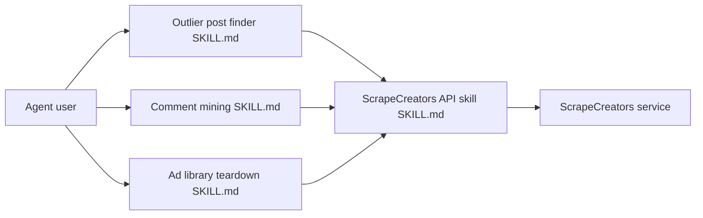

# ScrapeCreators/social-media-research-skills

> Thirteen agent skills for analyzing social media with the ScrapeCreators API, for marketers and analysts.

## The problem
Turning public TikTok, Instagram or YouTube data into a useful deliverable requires chaining API calls and writing the analysis.

## What it actually does
A set of skills in the Agent Skills format: outlier posts, transcripts, comments, competitors, ad libraries, trends, influencer prospecting, social listening, product demand, content repurposing. The `scrapecreators-api` skill serves as the data layer for the others. Each skill produces an artifact (table, report, CSV).

## How it is wired


## Trying it
```bash
npx skills add ScrapeCreators/social-media-research-skills
export SCRAPECREATORS_API_KEY=sk_...
```

## Cost and gotchas
The skills are free, but the ScrapeCreators API requires an account and a key (pricing is not detailed in the README). The repository is a promotional product of the API vendor.

## What it is not
Not a scraper: there is no executable code, only instructions for agents. Only public data is targeted, no private content. No guarantee about the platforms' terms of use.

## Alternatives
No alternative named in the README.

## For you
Watch: handy if you do marketing monitoring, but you are tied to a single vendor's paid service; little interest for pure data/ML use.
