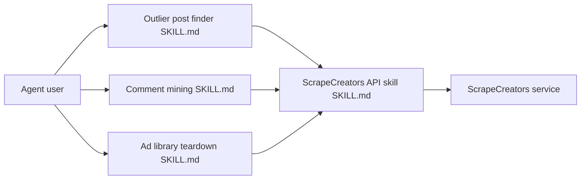

# ScrapeCreators/social-media-research-skills

> Treize skills d'agent pour analyser les réseaux sociaux avec l'API ScrapeCreators, pour marketeurs et analystes.

## Le problème
Transformer des données publiques TikTok, Instagram ou YouTube en livrable utile demande d'enchaîner les appels d'API et d'écrire l'analyse.

## Ce que ça fait vraiment
Un lot de skills au format Agent Skills : posts atypiques, transcriptions, commentaires, concurrents, bibliothèques de publicités, tendances, prospection d'influenceurs, écoute sociale, demande produit, réutilisation de contenus. Le skill `scrapecreators-api` sert de couche données aux autres. Chaque skill produit un artefact (tableau, rapport, CSV).

## Comment c'est branché


## Essayer
```bash
npx skills add ScrapeCreators/social-media-research-skills
export SCRAPECREATORS_API_KEY=sk_...
```

## Coût et pièges
Les skills sont gratuits, mais l'API ScrapeCreators demande un compte et une clé (offre tarifaire non détaillée dans le README). Le dépôt est un produit promotionnel de l'éditeur de l'API.

## Ce que ce n'est pas
Pas un scraper : il n'y a aucun code exécutable, seulement des instructions pour agents. Seules des données publiques sont visées, pas de contenu privé. Aucune garantie sur les conditions d'usage des plateformes.

## Alternatives
Aucune alternative nommée dans le README.

## Pour toi
À surveiller : pratique si tu fais de la veille marketing, mais tu es lié au service payant d'un fournisseur unique ; peu d'intérêt pour un usage data/ML pur.

