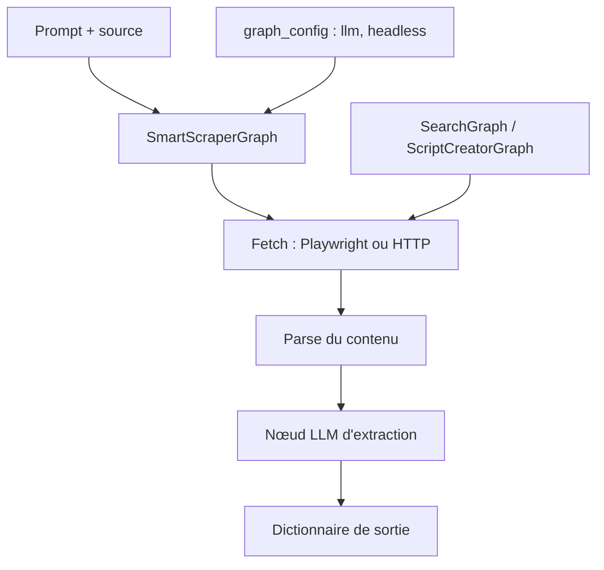

# ScrapeGraphAI/Scrapegraph-ai

> Python library that builds graph-based scraping pipelines driven by an LLM.

## The problem
A hand-written scraper breaks as soon as the page changes structure.
Describing what you want to extract is simple; writing the selectors that do it is not.

## What it actually does
You give a prompt and a source (URL or XML, HTML, JSON, Markdown file); the library builds the extraction pipeline and returns a dictionary.
Several standard pipelines: `SmartScraperGraph` (one page), `SearchGraph` (the top n results of a search engine), `SpeechGraph` (extraction + audio file), `ScriptCreatorGraph` (generates a Python script), plus multi-page variants that parallelize LLM calls.
Works with OpenAI, Groq, Azure, Gemini, MiniMax or local models via Ollama, by changing only the `llm` block of the configuration.
Integrations: Python and Node SDKs, LangChain, LlamaIndex, Crew.ai, Agno, CamelAI, Pipedream, Zapier, n8n, Dify, MCP server.

## How it is wired


## Trying it
```bash
pip install scrapegraphai
playwright install
```

```python
from scrapegraphai.graphs import SmartScraperGraph
graph_config = {"llm": {"model": "ollama/llama3.2", "model_tokens": 8192, "format": "json"}, "verbose": True, "headless": False}
smart_scraper_graph = SmartScraperGraph(prompt="Extract useful information from the webpage", source="https://scrapegraphai.com/", config=graph_config)
print(smart_scraper_graph.run())
```

## Cost and gotchas
MIT and free on the library side; LLM tokens are at your expense, or free locally via Ollama.
Anonymous usage telemetry is enabled by default: can be disabled with `SCRAPEGRAPHAI_TELEMETRY_ENABLED=false`.

## What it is not
It is not a managed service: proxies, anti-bot, JavaScript rendering and scaling remain your responsibility in the open source version.
It is not deterministic: extraction goes through an LLM, so it varies from run to run and is costly at scale.
The Crawl, Monitor and History features exist only in the paid managed API.

## Alternatives
- scrapegraph-py / scrapegraph-js — the SDKs of the same publisher's managed API, if you do not want to manage the infrastructure.

## For you
Good for occasionally extracting structured data from heterogeneous pages; measure the token cost before any mass processing.
