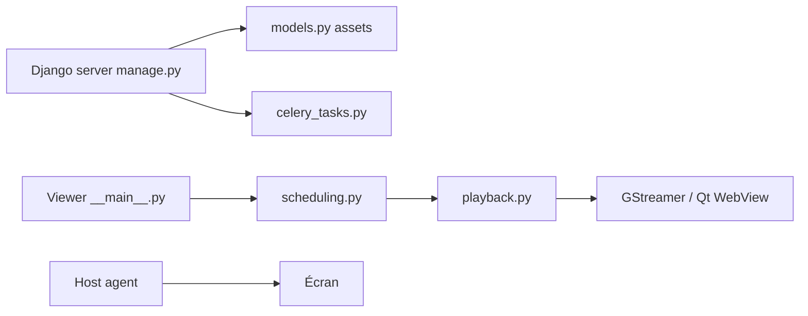

# Screenly/Anthias

> Digital signage software for Raspberry Pi and PC, derived from Screenly OSE.

## The problem
Driving display screens (images, videos, web pages) requires a reliable player and a simple management interface.

## What it actually does
Three Python processes run on the device: a Django server (interface, REST API v2, scheduling, ASGI), a player that picks the content and renders it through GStreamer or a Qt WebView, and a host agent (screen, HDMI-CEC, storage, power). Celery and Redis handle deferred tasks. Deployment through containers, balena or Ansible. 64-bit ARM boards other than the Raspberry Pi are supported on a best-effort basis.

## How it is wired

## Trying it
The install command is not in the README (it points to the installation page on the website). The repo provides `docker-compose.yml.tmpl`, `balena.yml` and `ansible/site.yml`.

## Cost and gotchas
Dedicated hardware. On non-Raspberry Pi boards, video is decoded in software: choppy at 1080p, unsuitable for 4K. Only Debian-based Armbian works.

## What it is not
It is not the paid Screenly product. Nothing to do with data or AI. The license is present but GitHub does not recognize it.

## Alternatives
Screenly, the paid version from which Anthias was split.

## For you
Ignore: digital signage with no link to AI or MLOps.
