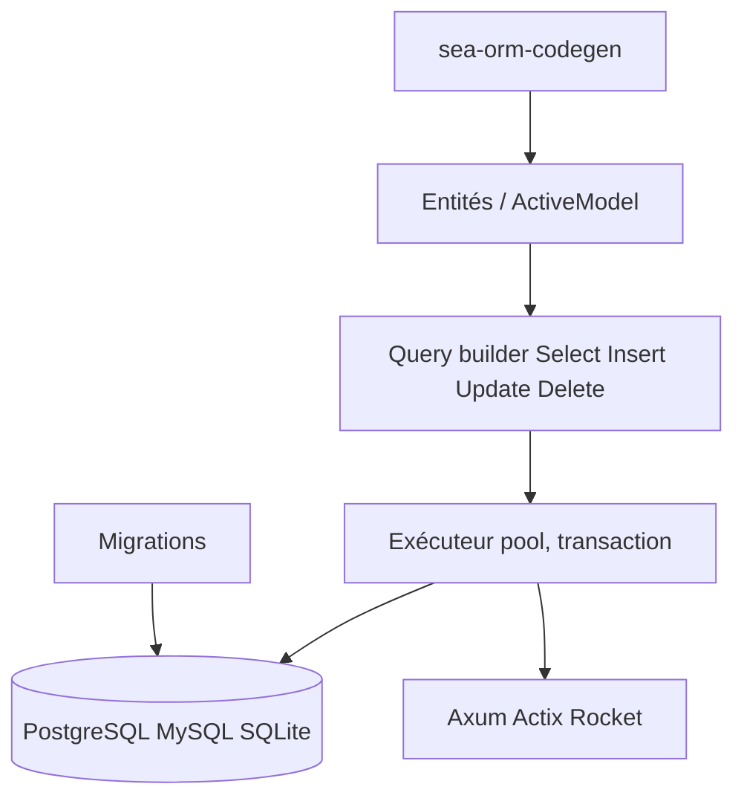

# SeaQL/sea-orm

> Async ORM for Rust, for those building web services on top of PostgreSQL, MySQL or SQLite.

## The problem
Hand-writing queries, relations and migrations in Rust is repetitive and error-prone.

## What it actually does
Typed entities, ActiveModel to insert, update and delete, 1-1, 1-N and M-N relations, loading that avoids N+1, partial models, raw SQL via `raw_sql!`, migrations and entity generation through `sea-orm-cli`. Version 2.0 brings a dense entity format and an "entity first" workflow.

## How it is wired


## Trying it
```toml
sea-orm = { version = "2", features = ["sqlx-postgres", "runtime-tokio"] }
sqlx = { version = "0.9", features = ["tls-rustls-aws-lc-rs"] }
```

## Cost and gotchas
Free. TLS is not enabled by default: you must choose a backend via sqlx. 2.0 is in release-candidate phase with breaking changes.

## What it is not
Not a Python ORM nor a data science tool. SeaORM Pro (admin panel) and Seaography are separate products.

## Alternatives
No alternative named in the README.

## For you
Worth watching: only relevant if you write services in Rust; otherwise irrelevant for a data/AI profile.
