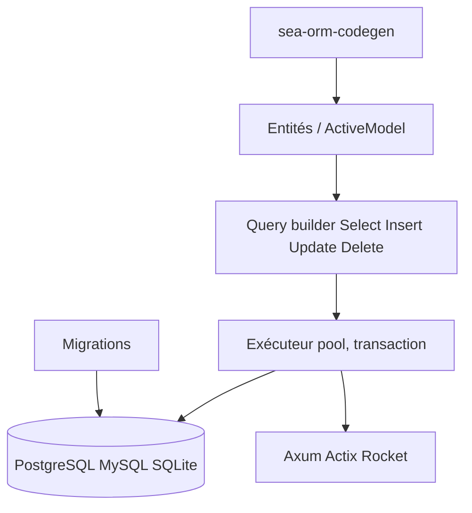

# SeaQL/sea-orm

> ORM asynchrone pour Rust, pour qui construit des services web au-dessus de PostgreSQL, MySQL ou SQLite.

## Le problème
Écrire à la main requêtes, relations et migrations en Rust est répétitif et sujet aux erreurs.

## Ce que ça fait vraiment
Entités typées, ActiveModel pour insérer, modifier, supprimer, relations 1-1, 1-N et M-N, chargement évitant le N+1, modèles partiels, SQL brut via `raw_sql!`, migrations et génération d'entités par `sea-orm-cli`. La version 2.0 apporte format d'entité dense et workflow « entity first ».

## Comment c'est branché


## Essayer
```toml
sea-orm = { version = "2", features = ["sqlx-postgres", "runtime-tokio"] }
sqlx = { version = "0.9", features = ["tls-rustls-aws-lc-rs"] }
```

## Coût et pièges
Gratuit. TLS non activé par défaut : il faut choisir un backend via sqlx. La 2.0 est en phase release candidate avec changements incompatibles.

## Ce que ce n'est pas
Pas un ORM Python ni un outil de data science. SeaORM Pro (panneau d'admin) et Seaography sont des produits à part.

## Alternatives
Aucune alternative nommée dans le README.

## Pour toi
À surveiller : seulement pertinent si tu écris des services en Rust ; sinon sans objet pour un profil data/IA.

