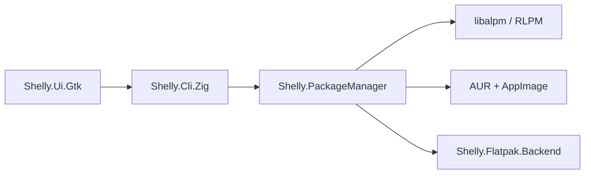

# Seafoam-Labs/Shelly-ALPM

> Graphical and command-line package manager for Arch Linux, with AUR and Flatpak.

## The problem
`pacman` and AUR helpers are austere for anyone who wants a visual interface.

## What it actually does
GTK4 interface and CLI in Zig on `libalpm` or an `rlpm` backend. Search, install, update, AUR with PKGBUILD review, isolated builds, AppImage, and optional Flatpak via a separate package. Config options in JSON (`~/.config/shelly/config.json`).

## How it is wired


## Trying it
```bash
sudo pacman -S shelly
shelly search standard firefox
shelly -Is zed --needed
```

## Cost and gotchas
Free. Reserved for Arch and derivatives. Building requires zig 0.16.0 and vala. The package is intended for CachyOS or the AUR.

## What it is not
Neither a cross-platform tool nor a tested replacement for `pacman`: the README talks about "version validation gates" for RLPM still open.

## Alternatives
No alternative named in the README (yay and paru are cited only as installers).

## For you
Ignore: an Arch tool unrelated to data/AI, useful only if you are on Arch and want an interface.
