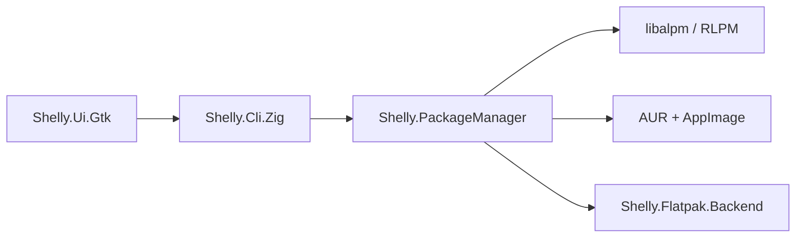

# Seafoam-Labs/Shelly-ALPM

> Gestionnaire de paquets graphique et en ligne de commande pour Arch Linux, avec AUR et Flatpak.

## Le problème
`pacman` et les assistants AUR sont austères pour qui veut une interface visuelle.

## Ce que ça fait vraiment
Interface GTK4 et CLI en Zig sur `libalpm` ou un backend `rlpm`. Recherche, installation, mise à jour, AUR avec relecture de PKGBUILD, constructions isolées, AppImage, et Flatpak en option via un paquet séparé. Options de config en JSON (`~/.config/shelly/config.json`).

## Comment c'est branché


## Essayer
```bash
sudo pacman -S shelly
shelly search standard firefox
shelly -Is zed --needed
```

## Coût et pièges
Gratuit. Réservé à Arch et dérivés. Compilation : zig 0.16.0 et vala. Le paquet est prévu pour CachyOS ou l'AUR.

## Ce que ce n'est pas
Ni outil multiplateforme ni remplaçant testé de `pacman` : le README parle de « portes de validation de version » pour RLPM encore ouvertes.

## Alternatives
Aucune alternative nommée dans le README (yay et paru cités seulement comme installateurs).

## Pour toi
À ignorer : outil Arch sans lien avec la data/IA, utile seulement si tu es sur Arch et veux une interface.

