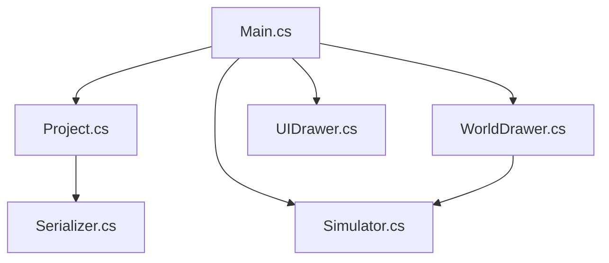

# SebLague/Digital-Logic-Sim

> Minimalist logic circuit simulator in Unity, born from a video series on how computers work.

## The problem
Seeing how gates, memories and processors are built from simple circuits.

## What it actually does
Unity project: you assemble chips from simpler chips, the simulation propagates signals, and projects are saved as JSON. Examples (adders, ALU, RAM, registers) are included. The simulation engine is separate from drawing and the interface, with a home-made rendering library (SebVis).

## How it is wired

## Trying it
No command documented in the README.

## Cost and gotchas
Free. Unity is required to open the project. The maintainer says they prefer performance fixes over new chips. Last push in May 2025.

## What it is not
Not a professional hardware simulator (VHDL, Verilog): it is an educational tool.

## Alternatives
No alternative named in the README.

## For you
Ignore: an educational toy about circuits, unrelated to data or AI work.
