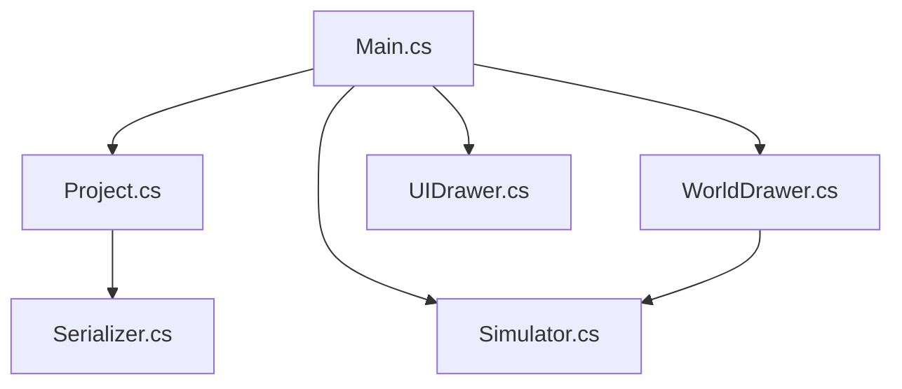

# SebLague/Digital-Logic-Sim

> Simulateur minimaliste de circuits logiques sous Unity, né d'une série vidéo sur le fonctionnement des ordinateurs.

## Le problème
Voir comment portes, mémoires et processeurs se construisent à partir de circuits simples.

## Ce que ça fait vraiment
Projet Unity : on assemble des puces à partir de puces plus simples, la simulation propage les signaux, et les projets s'enregistrent en JSON. Des exemples (additionneurs, UAL, RAM, registres) sont inclus. Le moteur de simulation est séparé du dessin et de l'interface, avec une bibliothèque de rendu maison (SebVis).

## Comment c'est branché

## Essayer
Aucune commande documentée dans le README.

## Coût et pièges
Gratuit. Il faut Unity pour ouvrir le projet. Le mainteneur dit préférer les corrections de performance aux nouvelles puces. Dernier push en mai 2025.

## Ce que ce n'est pas
Pas un simulateur de matériel professionnel (VHDL, Verilog) : c'est un outil pédagogique.

## Alternatives
Aucune alternative nommée dans le README.

## Pour toi
Ignorer : un jouet pédagogique sur les circuits, sans lien avec un travail data ou IA.

