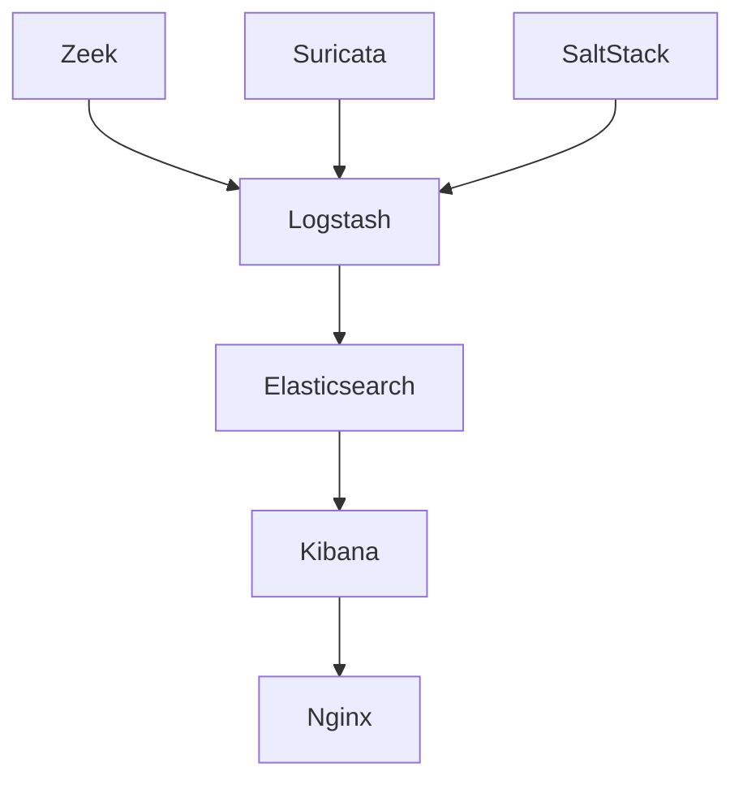

# Security-Onion-Solutions/securityonion

> Free Linux distribution for threat hunting, security monitoring and log management.

## The problem
Assembling network sensors, a search engine and an analysis console requires a lot of manual integration.

## What it actually does
A distribution shipped as an ISO that bundles the Security Onion console (SOC), the Elastic stack, intrusion detection (Suricata, Elastic Fleet), network metadata (Zeek or Suricata) and packet capture. SaltStack configures the nodes, sensors send to Logstash then Elasticsearch. A Pro offering adds AI and enterprise features.

## How it is wired


## Trying it
```bash
# Aucune commande documentée : télécharger l'ISO, puis suivre
# le guide d'installation et le guide matériel.
```

## Cost and gotchas
Free open version, paid Pro offering. Plan for significant hardware resources. License present but not recognized by GitHub: read it before use.

## What it is not
Not a simple package: it is a complete system to install on dedicated machines. Not an incident response tool.

## Alternatives
No alternative named in the README.

## For you
Worth watching: interesting for platform monitoring, but outside the data/AI core and the license needs clarifying.
