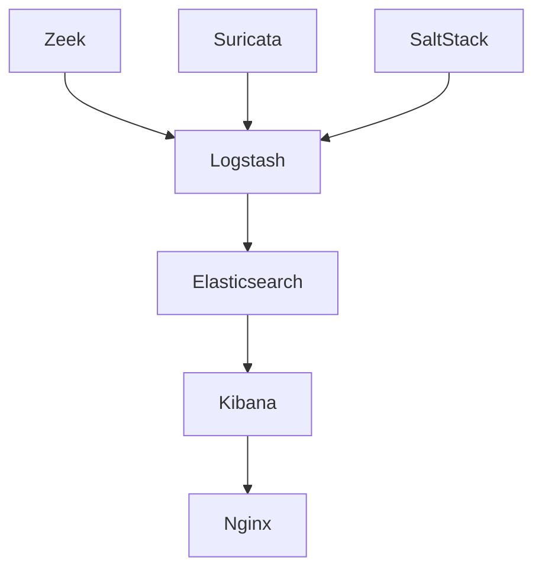

# Security-Onion-Solutions/securityonion

> Distribution Linux libre de chasse aux menaces, supervision de sécurité et gestion des journaux.

## Le problème
Assembler des sondes réseau, un moteur de recherche et une console d'analyse demande beaucoup d'intégration manuelle.

## Ce que ça fait vraiment
Une distribution livrée en ISO qui regroupe la console Security Onion (SOC), la pile Elastic, la détection d'intrusion (Suricata, Elastic Fleet), les métadonnées réseau (Zeek ou Suricata) et la capture de paquets. SaltStack configure les nœuds, les sondes envoient vers Logstash puis Elasticsearch. Une offre Pro ajoute une IA et des fonctions entreprise.

## Comment c'est branché


## Essayer
```bash
# Aucune commande documentée : télécharger l'ISO, puis suivre
# le guide d'installation et le guide matériel.
```

## Coût et pièges
Version libre gratuite, offre Pro payante. Ressources matérielles importantes à prévoir. Licence présente mais non reconnue par GitHub : à lire avant usage.

## Ce que ce n'est pas
Pas un simple paquet : c'est un système complet à installer sur des machines dédiées. Pas un outil de réponse à incident.

## Alternatives
Aucune alternative nommée dans le README.

## Pour toi
À surveiller : intéressant pour la supervision de plateforme, mais hors cœur de métier data/IA et licence à clarifier.

