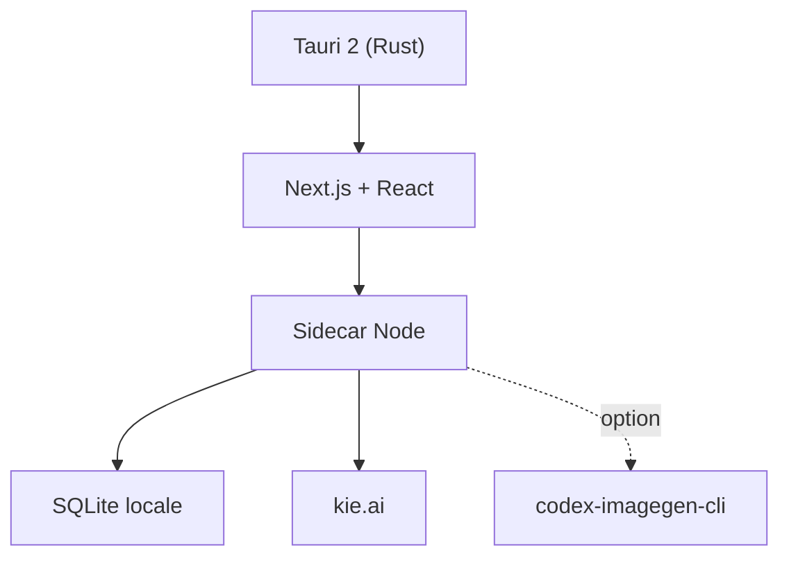

# SegFault42/HeliosGen

> Desktop application for chaining AI image and video generations on an infinite canvas.

## The problem
Generating images and videos with several models means juggling between interfaces, with no reusable pipeline.

## What it actually does
A node canvas links prompts, models and reference images, with parallel or sequential execution. Generations go through kie.ai (GPT Image 2, Nano Banana, Seedream, Veo 3.1, Kling, Seedance, Grok Imagine). History, folders and workflows are kept in a local SQLite database.

## How it is wired


## Trying it
```bash
git clone https://github.com/SegFault42/HeliosGen
cd HeliosGen
npm install
npm run desktop:build
```

## Cost and gotchas
A kie.ai key is mandatory, with credits bought by you. Only the macOS Apple Silicon build is published, unsigned. Node 22+ and Rust are needed to build. No license declared: reuse rights are unclear.

## What it is not
Not "100% local" for compute: the models run at kie.ai. No Windows or Linux build provided.

## Alternatives
No alternative named in the README (Codex CLI is an optional backend for GPT Image 2).

## For you
Worth watching: the visual pipeline idea is clear, but dependence on a SaaS and the lack of a license hold back any serious use.
