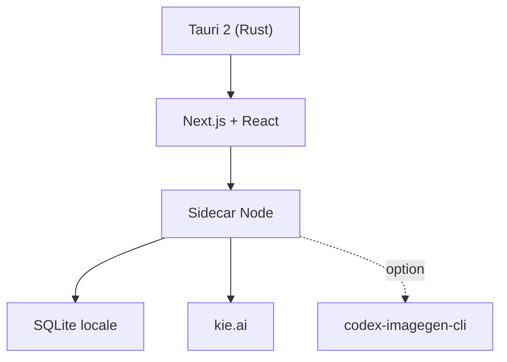

# SegFault42/HeliosGen

> Application de bureau pour enchaîner sur un canevas infini des générations d'images et de vidéos par IA.

## Le problème
Générer images et vidéos avec plusieurs modèles oblige à jongler entre interfaces, sans pipeline réutilisable.

## Ce que ça fait vraiment
Un canevas de nœuds relie prompts, modèles et images de référence, en exécution parallèle ou séquentielle. Les générations passent par kie.ai (GPT Image 2, Nano Banana, Seedream, Veo 3.1, Kling, Seedance, Grok Imagine). Historique, dossiers et workflows restent dans une base SQLite locale.

## Comment c'est branché


## Essayer
```bash
git clone https://github.com/SegFault42/HeliosGen
cd HeliosGen
npm install
npm run desktop:build
```

## Coût et pièges
Clé kie.ai obligatoire, crédits achetés par vous. Seul le build macOS Apple Silicon est publié, non signé. Node 22+ et Rust pour compiler. Aucune licence déclarée : droits de réutilisation flous.

## Ce que ce n'est pas
Pas « 100 % local » pour le calcul : les modèles tournent chez kie.ai. Pas de build Windows ni Linux fourni.

## Alternatives
Aucune alternative nommée dans le README (Codex CLI est un backend optionnel pour GPT Image 2).

## Pour toi
À surveiller : l'idée de pipeline visuel est claire, mais dépendance à un SaaS et absence de licence freinent tout usage sérieux.

