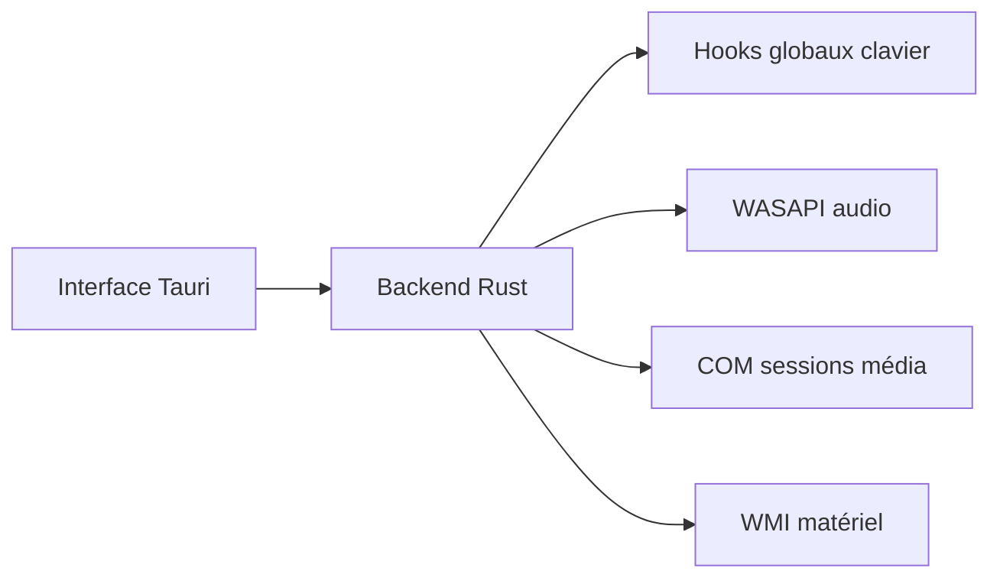

# SehajveerSingh2005/bloom

> Replaces the Windows taskbar with an animated dock and a notch-style "island".

## The problem
The Windows taskbar is static; the author wants an animated interface.

## What it actually does
An "island" at the top of the screen switches between music, control center (wifi, Bluetooth, volume), status (battery, weather) and a calendar with a Pomodoro timer. A dock replaces the native bar, with window previews. Rust backend, WASAPI audio, global hooks.

## How it is wired
Simplified diagram based on the sheet, no diagram provided.


## Trying it
```bash
git clone https://github.com/SehajveerSingh2005/bloom.git
cd bloom
bun install
bun run tauri dev
```

## Cost and gotchas
Free; Rust and Bun to build. The README mentions a Microsoft Defender alert, cleared according to the author after analysis. It intercepts keystrokes through global hooks: check before installing.

## What it is not
Not an overlay: it replaces the taskbar. Windows only.

## Alternatives
No alternative named in the README.

## For you
Ignore: Windows desktop theming, off-topic for data/AI/MLOps, with sensitive system hooks.
