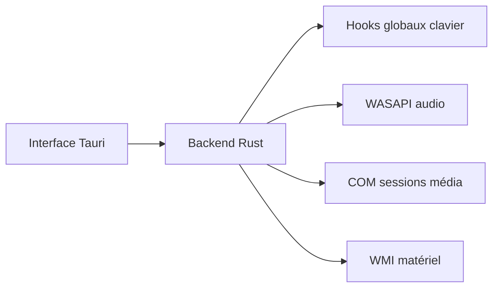

# SehajveerSingh2005/bloom

> Remplace la barre des tâches Windows par un dock animé et une « île » façon notch.

## Le problème
La barre des tâches Windows est statique ; l'auteur veut une interface animée.

## Ce que ça fait vraiment
Une « île » en haut de l'écran bascule entre musique, centre de contrôle (wifi, Bluetooth, volume), état (batterie, météo) et calendrier avec minuteur Pomodoro. Un dock remplace la barre native, avec aperçus de fenêtres. Backend Rust, audio WASAPI, hooks globaux.

## Comment c'est branché
Schéma simplifié d'après la fiche, sans diagramme fourni.


## Essayer
```bash
git clone https://github.com/SehajveerSingh2005/bloom.git
cd bloom
bun install
bun run tauri dev
```

## Coût et pièges
Gratuit ; Rust et Bun pour compiler. Le README signale une alerte Microsoft Defender, levée selon l'auteur après analyse. Il intercepte les touches par des hooks globaux : à vérifier avant installation.

## Ce que ce n'est pas
Pas une surcouche : il remplace la barre des tâches. Windows uniquement.

## Alternatives
Aucune alternative nommée dans le README.

## Pour toi
À ignorer : habillage de bureau Windows, hors sujet data/IA/MLOps, avec des hooks système sensibles.

