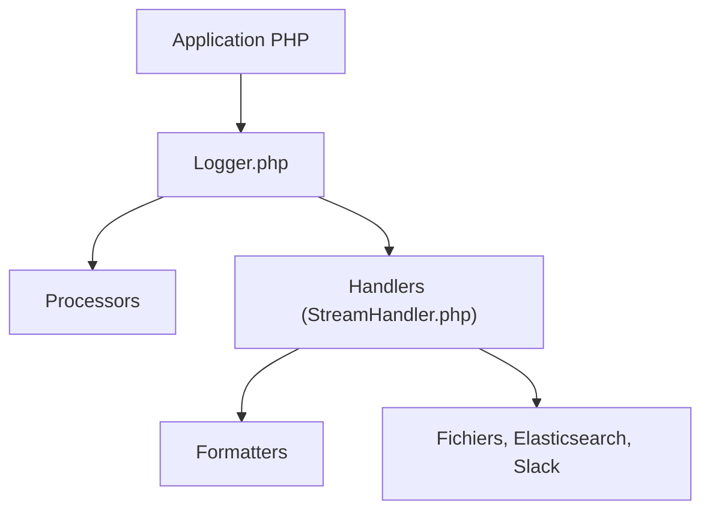

# Seldaek/monolog

> PSR-3 compliant PHP logging library that sends logs to files, sockets and web services.

## The problem
PHP applications need interchangeable logging to many destinations.

## What it actually does
`Logger` creates records, applies processors, then passes them to handlers (file, rotation, socket, Elasticsearch, Slack, Telegram, console) via formatters. `ErrorHandler` and `SignalHandler` convert errors and signals into logs. Integrated into Symfony, Laravel and Magento.

## How it is wired


## Trying it
```bash
composer require monolog/monolog
```
```php
$log = new Logger('name');
$log->pushHandler(new StreamHandler('path/to/your.log', Level::Warning));
$log->warning('Foo');
```

## Cost and gotchas
Monolog 3 requires PHP 8.1 or higher (2.x for PHP 7.2). No other cost.

## What it is not
Not an observability platform: a PHP log client. No centralization or search without an external service.

## Alternatives
No alternative named in the README.

## For you
Ignore: PHP only, outside a data/AI/MLOps stack; excellent for anyone doing PHP.
