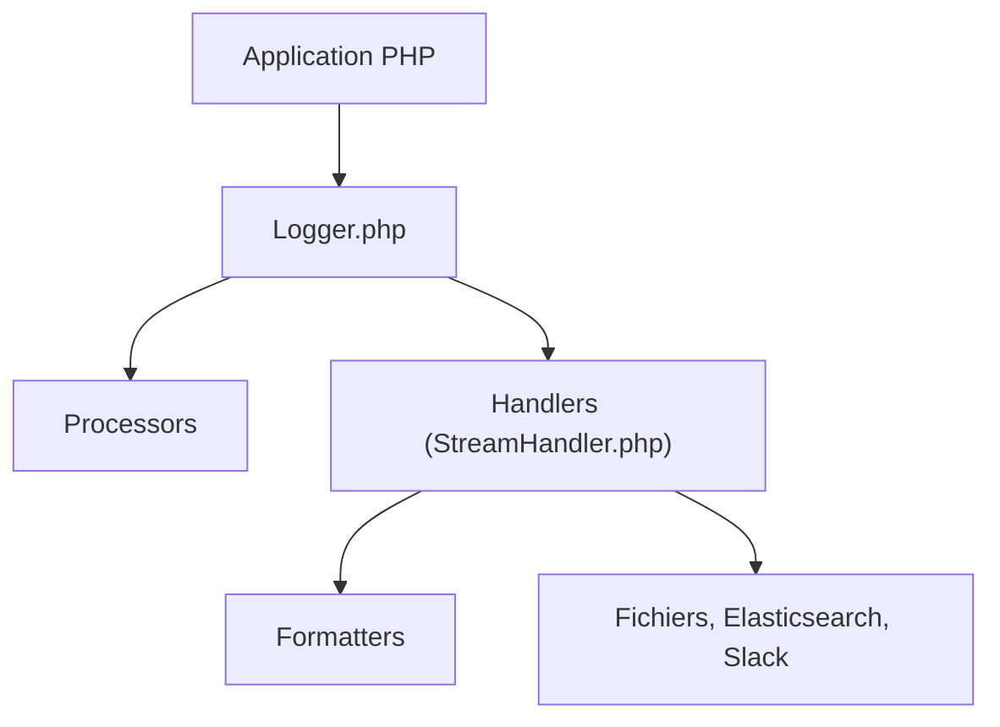

# Seldaek/monolog

> Bibliothèque de journalisation PHP conforme PSR-3, qui envoie les logs vers fichiers, sockets et services web.

## Le problème
Les applications PHP ont besoin d'un logging interchangeable vers de nombreuses destinations.

## Ce que ça fait vraiment
`Logger` crée des enregistrements, applique des processeurs, puis les passe à des handlers (fichier, rotation, socket, Elasticsearch, Slack, Telegram, console) via formateurs. `ErrorHandler` et `SignalHandler` convertissent erreurs et signaux en logs. Intégré à Symfony, Laravel et Magento.

## Comment c'est branché


## Essayer
```bash
composer require monolog/monolog
```
```php
$log = new Logger('name');
$log->pushHandler(new StreamHandler('path/to/your.log', Level::Warning));
$log->warning('Foo');
```

## Coût et pièges
Monolog 3 exige PHP 8.1 ou plus (2.x pour PHP 7.2). Aucun autre coût.

## Ce que ce n'est pas
Pas une plateforme d'observabilité : un client de logs PHP. Pas de centralisation ou de recherche sans service externe.

## Alternatives
Aucune alternative nommée dans le README.

## Pour toi
Ignorer : PHP seulement, hors d'une pile data/IA/MLOps ; excellent pour qui fait du PHP.

