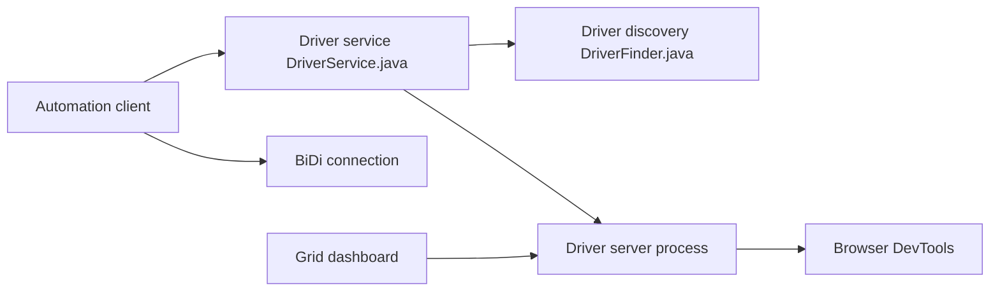

# SeleniumHQ/selenium

> Browser automation project implementing the W3C WebDriver standard, with multi-language bindings.

## The problem
Driving a browser programmatically in the same way across all browsers and languages.

## What it actually does
Driver services (Chrome, Edge, Firefox, Safari), driver discovery, Internet Explorer driver, WebDriver BiDi support (storage), Grid with a dashboard. Bindings for Java, Python, Ruby, C#, JavaScript, Rust. The README is aimed at contributors; usage is in the user manual.

## How it is wired


## Trying it
```bash
./go py:local_dev
./go py:install
bazel build grid
```

## Cost and gotchas
Free. Building the repository requires Bazelisk, JDK 17 or later and, on Windows, a lengthy setup (MSYS2, long paths).

## What it is not
Not a turnkey scraping or visual testing tool: it is driving infrastructure.

## Alternatives
No alternative named in the README.

## For you
Worth watching: useful for browser-based data collection or end-to-end tests, to be compared with what you already use.
