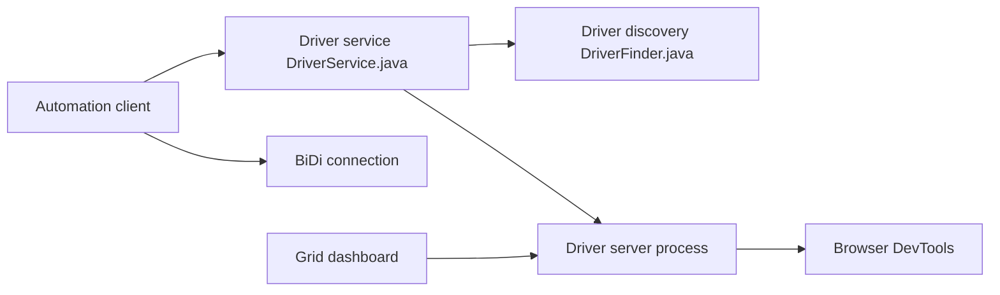

# SeleniumHQ/selenium

> Projet d'automatisation de navigateurs implémentant le standard W3C WebDriver, avec liaisons multilingues.

## Le problème
Piloter un navigateur par programme de la même manière dans tous les navigateurs et langages.

## Ce que ça fait vraiment
Services de pilotes (Chrome, Edge, Firefox, Safari), découverte du pilote, pilote Internet Explorer, support WebDriver BiDi (stockage), Grid avec tableau de bord. Liaisons Java, Python, Ruby, C#, JavaScript, Rust. Le README s'adresse aux contributeurs ; l'usage est dans le manuel utilisateur.

## Comment c'est branché


## Essayer
```bash
./go py:local_dev
./go py:install
bazel build grid
```

## Coût et pièges
Gratuit. Compiler le dépôt demande Bazelisk, JDK 17 ou plus et, sous Windows, une configuration longue (MSYS2, chemins longs).

## Ce que ce n'est pas
Pas un outil de scraping clé en main ni de test visuel : c'est une infrastructure de pilotage.

## Alternatives
Aucune alternative nommée dans le README.

## Pour toi
À surveiller : utile pour la collecte de données via navigateur ou des tests de bout en bout, à comparer à ce que tu utilises déjà.

