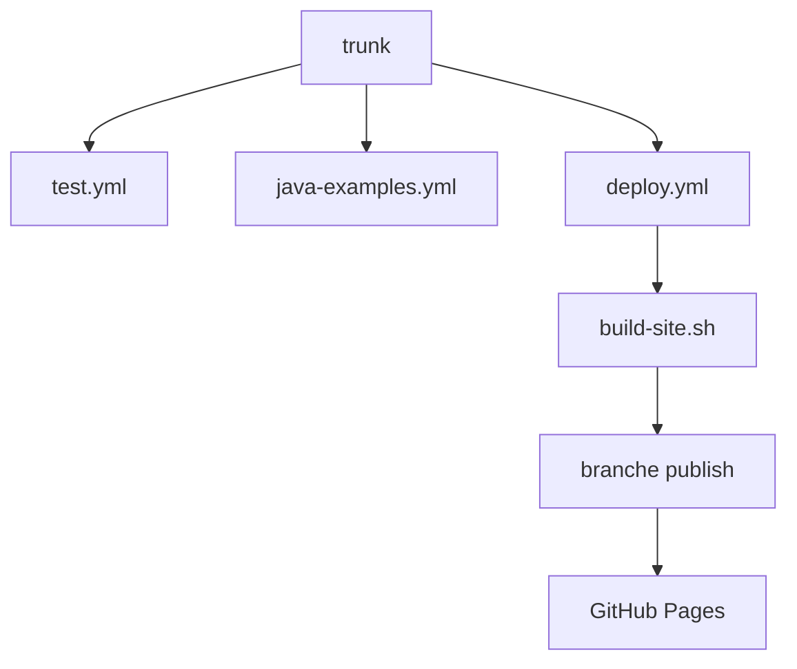

# SeleniumHQ/seleniumhq.github.io

> Sources of the official Selenium website and documentation, built with Hugo and the Docsy theme.

## The problem
To contribute to the Selenium documentation, you need to know how the site is built, tested and published.

## What it actually does
Contains the Markdown content in `website_and_docs`, code examples in six languages validated in CI, and GitHub Actions workflows. A commit on `trunk` containing `[deploy site]` triggers `build-site.sh`, which pushes the generated site to the `publish` branch, served by GitHub Pages.

## How it is wired


## Trying it
```bash
cd website_and_docs
npm install
hugo server
```

## Cost and gotchas
Free. Hugo extended 0.169.0 recommended, Go and Node.js (LTS 24) required. `npm install` is mandatory, otherwise the build fails on SCSS errors.

## What it is not
Not the Selenium code: only its website and documentation.

## Alternatives
No alternative named in the README.

## For you
Ignore: useful only for contributing to the Selenium documentation, not for your data or AI work.
