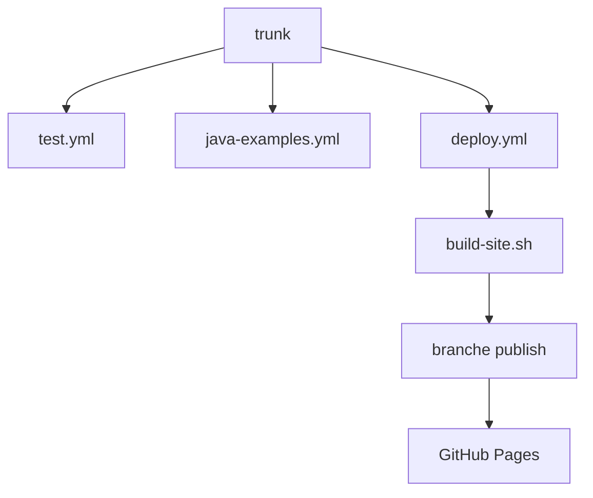

# SeleniumHQ/seleniumhq.github.io

> Sources du site officiel et de la documentation de Selenium, construits avec Hugo et le thème Docsy.

## Le problème
Pour contribuer à la documentation Selenium, il faut savoir comment le site est construit, testé et publié.

## Ce que ça fait vraiment
Contient le contenu Markdown dans `website_and_docs`, des exemples de code en six langages validés en CI, et des workflows GitHub Actions. Un commit sur `trunk` contenant `[deploy site]` déclenche `build-site.sh`, qui pousse le site généré vers la branche `publish`, servie par GitHub Pages.

## Comment c'est branché


## Essayer
```bash
cd website_and_docs
npm install
hugo server
```

## Coût et pièges
Gratuit. Hugo étendu 0.169.0 recommandé, Go et Node.js (LTS 24) requis. `npm install` est obligatoire sinon le build échoue sur des erreurs SCSS.

## Ce que ce n'est pas
Pas le code de Selenium : seulement son site et sa documentation.

## Alternatives
Aucune alternative nommée dans le README.

## Pour toi
Ignorer : utile seulement pour contribuer à la documentation Selenium, pas pour ton travail data ou IA.

