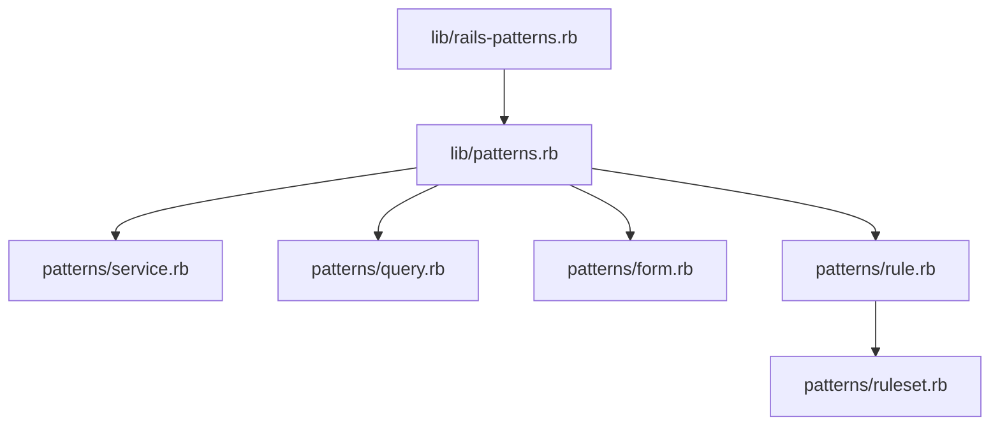

# Selleo/pattern

> Ruby on Rails gem of lightweight patterns: Query, Service, Collection, Form, Calculation, Rule.

## The problem
Rails models grow and mix queries, processes, forms and business rules.

## What it actually does
Provides base classes: Query objects (ActiveRecord relations), Service (`call` method, result via `result`), Collection, Form (validations, replaces strong parameters), Calculation (cached result) and Rule / Ruleset (composable conditional logic, `force` option).

## How it is wired


## Trying it
```bash
# Dans le Gemfile : gem "rails-patterns"
bundle install
```

## Cost and gotchas
Free. Requires Ruby on Rails. Last push in August 2024. Forms rely on Virtus.

## What it is not
Not a standalone framework: it assumes Rails and ActiveRecord.

## Alternatives
- business_process: higher-level abstraction than Service, cited by the README.

## For you
Concerns Rails development, not data / AI; with no recent update, ignore.
