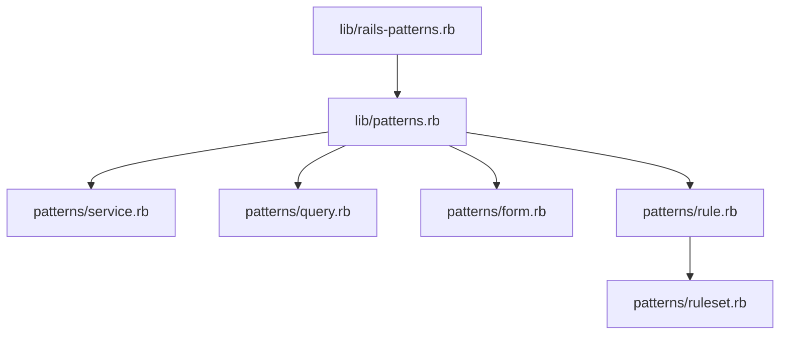

# Selleo/pattern

> Gem Ruby on Rails de patrons légers : Query, Service, Collection, Form, Calculation, Rule.

## Le problème
Les modèles Rails grossissent et mélangent requêtes, processus, formulaires et règles métier.

## Ce que ça fait vraiment
Fournit des classes de base : objets Query (relations ActiveRecord), Service (méthode `call`, résultat via `result`), Collection, Form (validations, remplace les strong parameters), Calculation (résultat mis en cache) et Rule / Ruleset (logique conditionnelle composable, option `force`).

## Comment c'est branché


## Essayer
```bash
# Dans le Gemfile : gem "rails-patterns"
bundle install
```

## Coût et pièges
Gratuit. Nécessite Ruby on Rails. Dernier push en août 2024. Les formulaires s'appuient sur Virtus.

## Ce que ce n'est pas
Pas un framework autonome : il suppose Rails et ActiveRecord.

## Alternatives
- business_process : abstraction plus haut niveau que Service, citée par le README.

## Pour toi
Concerne le développement Rails, pas la data / IA ; sans mise à jour récente, à ignorer.

