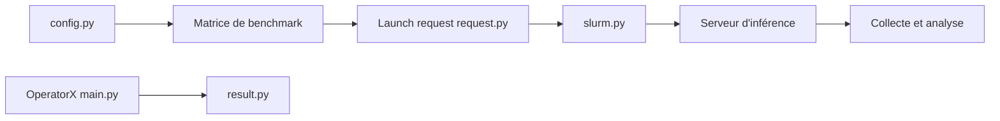

# SemiAnalysisAI/InferenceX

> Continuous benchmarking platform for LLM inference engines on GPU hardware, with a public dashboard.

## The problem
Frozen inference benchmarks age quickly, while the engines (vLLM, SGLang, TensorRT-LLM) progress every week.

## What it actually does
The README provided stops after the "Why?" section: it describes the goal (tracking performance in near real time) and points to the dashboard at inferencex.com. From the code, the tooling launches serving benchmarks through a cluster scheduler (Slurm), collects and analyzes the results, with evaluations, CollectiveX (communications) and OperatorX (operators per hardware backend).

## How it is wired

## Trying it
No command documented in the README provided (truncated text); the public dashboard is the stated entry point.

## Cost and gotchas
Reproducing the measurements requires GPU clusters. The README specifies that only this repository carries the official results; copies must be marked unofficial. 278 open issues.

## What it is not
Not a tool for serving models: it is a measurement bench. The mentions of trust by large companies are claims from the README, unverified.

## Alternatives
No alternative named in the README.

## For you
Worth watching: useful for choosing an inference engine and hardware from up-to-date figures, even without rerunning the benchmarks.
