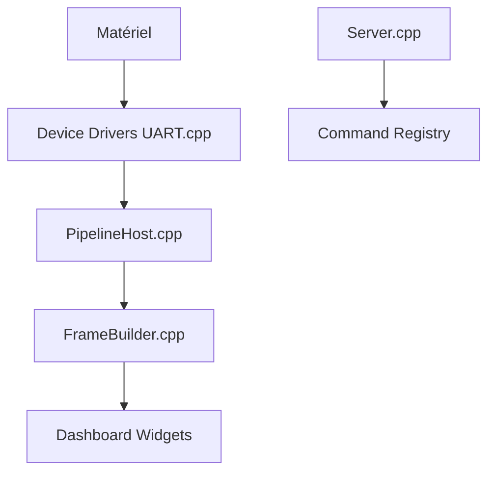

# Serial-Studio/Serial-Studio

> Real-time dashboard that turns serial, network or industrial bus data into charts.

## The problem
Work on sensors requires several tools: serial monitor, plotter, data logger and industrial monitor.

## What it actually does
Reads UART, Bluetooth LE and sockets (GPL edition), plus MQTT, Modbus, CAN, OPC UA and others (Pro). A project file describes the format; frame parsers (built-in templates, JavaScript, Lua) feed charts, gauges, maps. CSV export; TCP API (port 7777), gRPC (port 8888) and MCP server.

## How it is wired


## Trying it
```bash
brew install --cask serial-studio
chmod +x Serial-Studio-Pro-<version>-Linux-x64.AppImage
./Serial-Studio-Pro-<version>-Linux-x64.AppImage
cmake -B build -DPRODUCTION_OPTIMIZATION=ON -DCMAKE_BUILD_TYPE=Release
cmake --build build --config Release -j$(nproc)
```

## Cost and gotchas
Dual license: the GPL edition excludes the Pro features. The official binary offers a 14-day Pro trial; commercial use requires a Pro license. Qt 6.9+ required to build.

## What it is not
Not fully free: many features and files are under a commercial license. The AI assistant is reserved for Pro.

## Alternatives
No alternative named for the use case, apart from cited comparisons (Arduino Serial Plotter, Grafana, LabVIEW).

## For you
Worth watching: relevant for embedded telemetry, but mixed license and a single maintainer.
