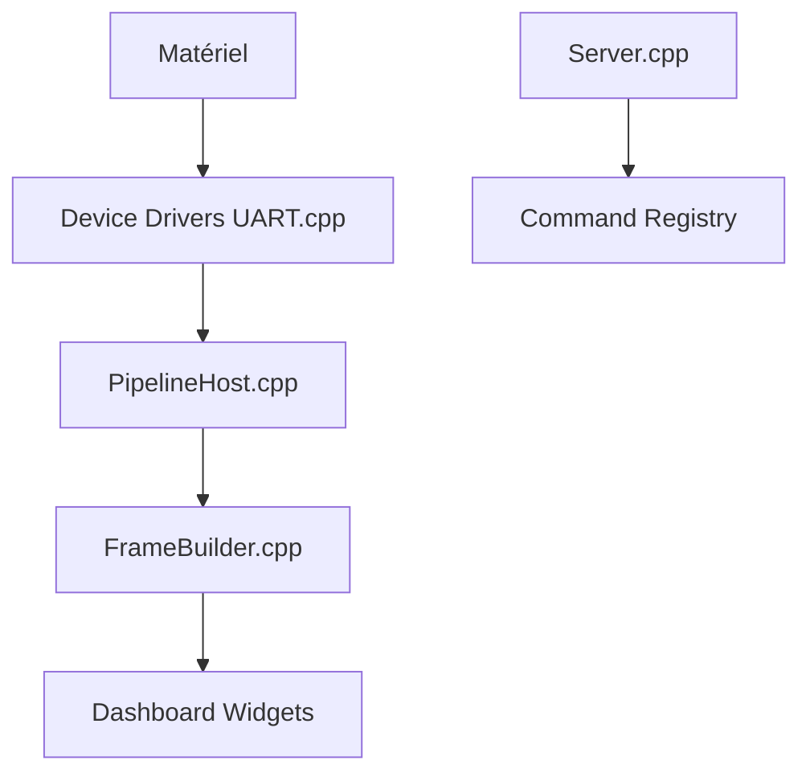

# Serial-Studio/Serial-Studio

> Tableau de bord temps réel qui transforme les données série, réseau ou bus industriels en graphiques.

## Le problème
Le travail sur capteurs exige plusieurs outils : moniteur série, traceur, enregistreur de données et moniteur industriel.

## Ce que ça fait vraiment
Lit UART, Bluetooth LE et sockets (édition GPL), plus MQTT, Modbus, CAN, OPC UA et autres (Pro). Un fichier projet décrit le format ; des analyseurs de trames (modèles intégrés, JavaScript, Lua) alimentent graphiques, jauges, cartes. Export CSV ; API TCP (port 7777), gRPC (port 8888) et serveur MCP.

## Comment c'est branché


## Essayer
```bash
brew install --cask serial-studio
chmod +x Serial-Studio-Pro-<version>-Linux-x64.AppImage
./Serial-Studio-Pro-<version>-Linux-x64.AppImage
cmake -B build -DPRODUCTION_OPTIMIZATION=ON -DCMAKE_BUILD_TYPE=Release
cmake --build build --config Release -j$(nproc)
```

## Coût et pièges
Double licence : l'édition GPL exclut les fonctions Pro. Le binaire officiel offre 14 jours d'essai Pro ; l'usage commercial exige une licence Pro. Qt 6.9+ requis pour compiler.

## Ce que ce n'est pas
Pas entièrement libre : de nombreuses fonctions et des fichiers sont sous licence commerciale. L'assistant IA est réservé à Pro.

## Alternatives
Aucune alternative nommée pour l'usage, hors comparatifs cités (Arduino Serial Plotter, Grafana, LabVIEW).

## Pour toi
À surveiller : pertinent pour de la télémétrie embarquée, mais licence mixte et mainteneur unique.

