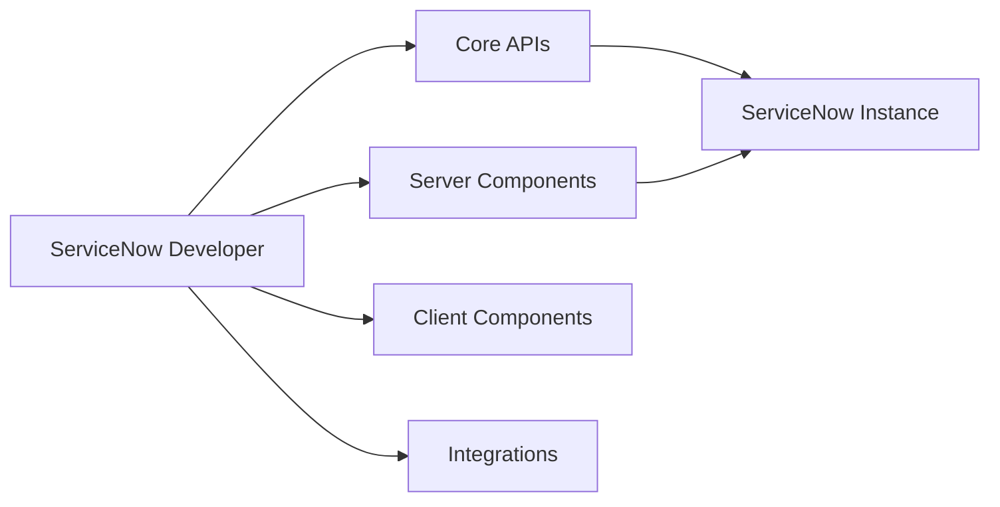

# ServiceNowDevProgram/code-snippets

> Community collection of ServiceNow code snippets, sorted into six categories, for platform developers.

## The problem
Find concrete examples of GlideRecord, business rules or REST integrations.

## What it actually does
Repository of snippet folders (JavaScript), each with its own README, spread over six categories: core APIs, server components, client components, modern development, integrations, specialized domains. The snippets are independent, with no shared execution. Contributions guided by CONTRIBUTING.md (Hacktoberfest).

## How it is wired


## Trying it
```bash
# Aucune commande dans le README : parcourir les catégories, copier un extrait, l'adapter dans l'instance.
```

## Cost and gotchas
Free; a ServiceNow instance is needed to use the code. License: none declared. Last push on 2025-10-31.

## What it is not
Not directly importable into ServiceNow, nor officially verified or supported: community code to review.

## Alternatives
Main Hacktoberfest repository of ServiceNowDevProgram (mentioned without a precise name).

## For you
Ignore: only useful to ServiceNow developers, and with no clear license.
