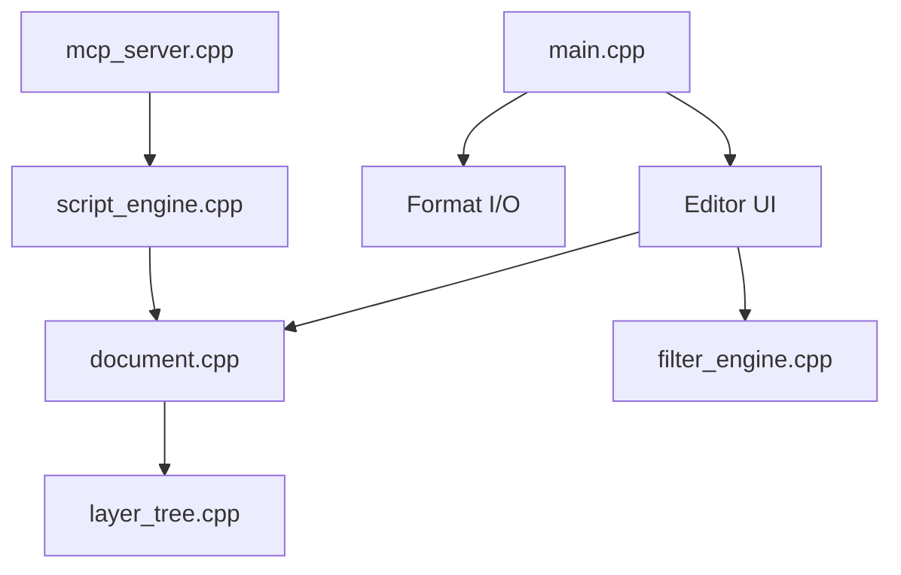

# SethRobinson/Patchy

> Free PSD-compatible image editor, on Windows, macOS, Linux and browser, for graphic designers.

## The problem
Opening and saving PSDs while keeping text, masks, styles and smart objects editable, without Photoshop.

## What it actually does
C++ editor with layers, brushes, selections, vectors, filters (including G'MIC), import from Affinity, Krita, GIMP, OpenRaster, Paint.NET and PDF. It offers a JavaScript engine, batch processing and a local MCP connector to drive the editor from an AI agent. The optional OpenAI tools use your key.

## How it is wired


## Trying it
```bash
flatpak install --user https://rtsoft.com/flatpak/com.rtsoft.patchy.flatpakref
flatpak run com.rtsoft.patchy
```

## Cost and gotchas
Free. The OpenAI Image Tools features are billed to your OpenAI account with your key. Updates contact GitHub. No GPU acceleration; RGB editing only.

## What it is not
Not a full Photoshop clone: CMYK limited to proofing and export, Affinity import with limits. Developed with significant help from AI tools, according to the author.

## Alternatives
No alternative named in the README as a replacement; it compares itself to Photoshop on PSD compatibility.

## For you
Ignore: image editing tool, only the MCP connector touches AI and it does not serve your data work.
