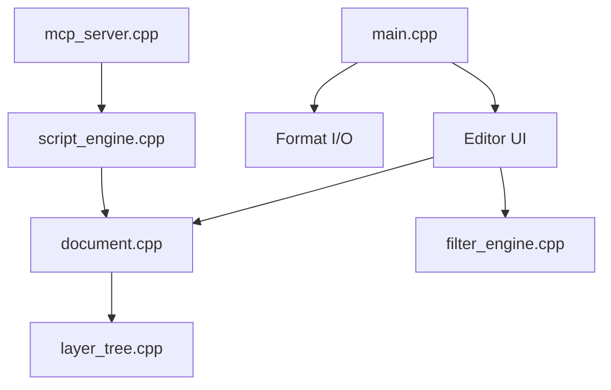

# SethRobinson/Patchy

> Éditeur d'images libre compatible PSD, sur Windows, macOS, Linux et navigateur, pour graphistes.

## Le problème
Ouvrir et enregistrer des PSD en gardant textes, masques, styles et objets dynamiques éditables, sans Photoshop.

## Ce que ça fait vraiment
Éditeur C++ avec calques, pinceaux, sélections, vecteurs, filtres (dont G'MIC), import d'Affinity, Krita, GIMP, OpenRaster, Paint.NET et PDF. Il offre un moteur JavaScript, un traitement par lot et un connecteur MCP local pour piloter l'éditeur par un agent IA. Les outils OpenAI optionnels utilisent ta clé.

## Comment c'est branché


## Essayer
```bash
flatpak install --user https://rtsoft.com/flatpak/com.rtsoft.patchy.flatpakref
flatpak run com.rtsoft.patchy
```

## Coût et pièges
Gratuit. Les fonctions OpenAI Image Tools sont facturées sur ton compte OpenAI avec ta clé. Les mises à jour contactent GitHub. Pas d'accélération GPU ; édition en RGB seulement.

## Ce que ce n'est pas
Pas un clone complet de Photoshop : CMYK limité à l'épreuvage et à l'export, import Affinity avec limites. Développé avec une aide importante d'outils IA, selon l'auteur.

## Alternatives
Aucune alternative nommée dans le README comme remplaçant ; il se compare à Photoshop sur la compatibilité PSD.

## Pour toi
À ignorer : outil de retouche d'image, seul le connecteur MCP touche à l'IA et il ne sert pas ton travail data.

