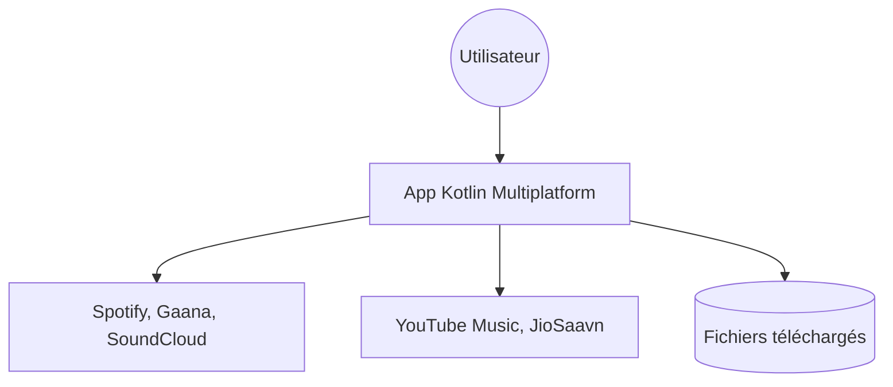

# Shabinder/SpotiFlyer

> Cross-platform Kotlin music downloader for Spotify, YouTube, Gaana, JioSaavn and SoundCloud.

## The problem
Replaying playlists via streaming consumes data and depends on the network.

## What it actually does
Finds the tracks of albums and playlists via YouTube Music or JioSaavn, then downloads them. Android, desktop and web (beta). Analytics and error reports are optional, disabled by default and self-hosted.

## How it is wired
Architecture not documented in the README provided.


## Trying it
```bash
# Installation par paquets de la page Releases (APK, MSI, DEB, JAR)
# JAR : nécessite Java installé
```

## Cost and gotchas
Free. Last push on 2024-10-06; the README announces that SpotiFlyer will no longer receive updates in favor of Soundbound. It works only if YouTube Music or JioSaavn is available in your country.

## What it is not
Not maintained. The README warns that downloading protected music may be illegal. GPL-3.0 license.

## Alternatives
- Soundbound: successor announced by the author.

## For you
Ignore: discontinued project, legal risk, no connection with data or AI work.
