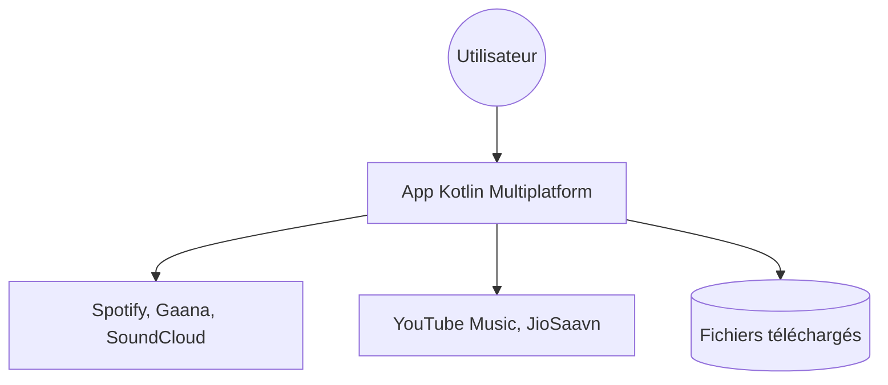

# Shabinder/SpotiFlyer

> Téléchargeur de musique Kotlin multiplateforme pour Spotify, YouTube, Gaana, JioSaavn et SoundCloud.

## Le problème
Réécouter des playlists en streaming consomme des données et dépend du réseau.

## Ce que ça fait vraiment
Retrouve les morceaux d'albums et de playlists via YouTube Music ou JioSaavn, puis les télécharge. Android, bureau et web (bêta). Analytique et rapports d'erreurs sont optionnels, désactivés par défaut et auto-hébergés.

## Comment c'est branché
Architecture non documentée dans le README fourni.


## Essayer
```bash
# Installation par paquets de la page Releases (APK, MSI, DEB, JAR)
# JAR : nécessite Java installé
```

## Coût et pièges
Gratuit. Dernier push le 2024-10-06 ; le README annonce que SpotiFlyer ne recevra plus de mises à jour au profit de Soundbound. Le fonctionnement dépend de la disponibilité de YouTube Music ou JioSaavn dans ton pays.

## Ce que ce n'est pas
Pas maintenu. Le README avertit que télécharger de la musique protégée peut être illégal. Licence GPL-3.0.

## Alternatives
- Soundbound : successeur annoncé par l'auteur.

## Pour toi
Ignorer : projet arrêté, risque juridique, aucun rapport avec un travail data ou IA.

