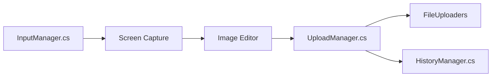

# ShareX/ShareX

> Windows tool for screen capture, recording, annotation and automated sharing.

## The problem
Capturing, annotating then sharing an image or video takes several applications and manual steps.

## What it actually does
Full-screen, window, region, scrolling and video/GIF capture (via FFmpeg). Built-in image editor (blur, arrows, text). After capture: copy, save, upload to many destinations (S3, GCS, R2, custom uploaders), OCR, QR code, history. Configurable keyboard shortcuts.

## How it is wired

## Trying it
The README points to the website and to the Microsoft Store, Steam and GitHub releases; no command appears there.

## Cost and gotchas
Free, no account. Windows only according to the README (the architecture mentions an Avalonia shell, unexplained). Uploads to S3 or R2 assume your own credentials.

## What it is not
Not a cross-platform tool. Not a full image editor.

## Alternatives
No alternative named in the README.

## For you
Ignore: Windows desktop tool unrelated to data or AI, except for documenting your work with screenshots.
