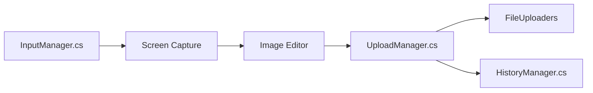

# ShareX/ShareX

> Outil Windows de capture d'écran, d'enregistrement, d'annotation et de partage automatisé.

## Le problème
Capturer, annoter puis partager une image ou une vidéo demande plusieurs applications et des étapes manuelles.

## Ce que ça fait vraiment
Capture plein écran, fenêtre, région, défilement et vidéo/GIF (via FFmpeg). Éditeur d'images intégré (flou, flèches, texte). Après capture : copie, sauvegarde, envoi vers de nombreuses destinations (S3, GCS, R2, uploaders personnalisés), OCR, QR code, historique. Raccourcis clavier configurables.

## Comment c'est branché

## Essayer
Le README renvoie au site et aux Microsoft Store, Steam et GitHub releases ; aucune commande n'y figure.

## Coût et pièges
Gratuit, sans compte. Windows uniquement d'après le README (l'architecture mentionne un shell Avalonia, non expliqué). Les envois vers S3 ou R2 supposent tes propres identifiants.

## Ce que ce n'est pas
Pas un outil multiplateforme. Pas un éditeur d'images complet.

## Alternatives
Aucune alternative nommée dans le README.

## Pour toi
Ignorer : outil de bureau Windows sans lien avec la data ou l'IA, sauf pour documenter tes travaux par captures.

