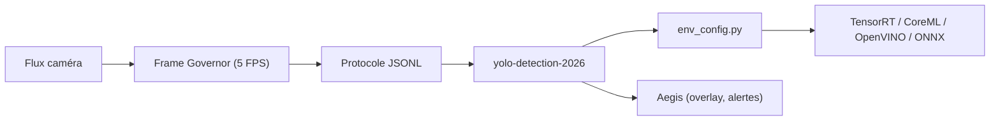

# SharpAI/DeepCamera

> Platform of vision "skills" for cameras (detection, segmentation, privacy), driven by the Aegis application.

## The problem
Plugging detection models into camera streams means adapting each model to the hardware (NVIDIA, Apple, Intel, Coral).

## What it actually does
Each skill is a module with its `SKILL.md`, talking JSONL over stdin/stdout with Aegis. The `env_config.py` selector detects the GPU and converts YOLO26 to TensorRT, CoreML, OpenVINO or ONNX. Ready skills: YOLO detection, Coral TPU, SAM2, depth estimation (anonymization), annotation, HomeSec-Bench (143 LLM/VLM tests). Others are planned (face recognition, license plates). An LLM agent installs the skills. The repository also keeps legacy applications (Node, face embeddings, Celery).

## How it is wired

## Trying it
The README gives no command for the skills: installation goes through the Aegis button (application to download). For the older applications: `sharpai-cli deepcamera start`.

## Cost and gotchas
Free; the Aegis desktop version is a separate download whose terms are not described. Alerts can be sent to Discord, Telegram, Slack. Part of the catalog is only "planned". The benchmark figures (72%, 96%, 98%) are the author's own.

## What it is not
Not a turnkey video surveillance software: a platform under construction, with heterogeneous legacy code.

## Alternatives
Not documented in the README.

## For you
Keep an eye on it: the automatic conversion to the right hardware backend and HomeSec-Bench are instructive; the rest is still planning.
