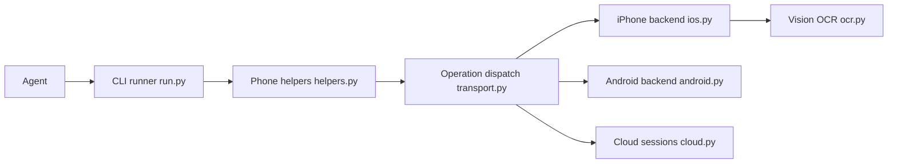

# ShawnPana/phone-harness

> CLI that lets an agent control a real iPhone or Android, or a phone rented in the cloud.

## The problem
An agent cannot see a phone's screen and cannot touch or type, short of a jailbreak or an app installed on it.

## What it actually does
A Python script received by the CLI calls helpers (`tap_text`, `type_text`, `screen`) sent to a backend. iPhone: the Mac's iPhone Mirroring window, Apple Vision OCR, HID events. Android: ADB, accessibility tree. A cloud iPhone or Android is driven over HTTPS (OCR on the host side). A `phone-harness doctor` checks the chain.

## How it is wired


## Trying it
```bash
phone-harness --version
phone-harness cloud login
phone-harness cloud start
phone-harness cloud stop
```

## Cost and gotchas
Local use is free; only cloud Android phones are billed by the minute (first 100 minutes free). Connecting the phone remains your job (Accessibility, Screen Recording, ADB debugging). The repository contains a `telemetry.py` module whose content the README does not describe.

## What it is not
No multi-touch, no camera, no Face ID; DRM video shows up black. OCR reads text, not icons without a label.

## Alternatives
No alternative named in the README.

## For you
Worth watching: interesting for making an agent act on mobile without a dedicated server, but recent (August 2026), a single maintainer and an undocumented telemetry module.
