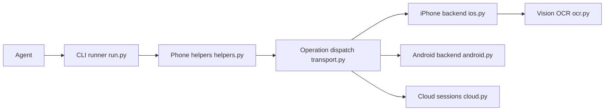

# ShawnPana/phone-harness

> CLI qui laisse un agent contrôler un vrai iPhone ou Android, ou un téléphone loué dans le cloud.

## Le problème
Un agent ne voit pas l'écran d'un téléphone et ne peut ni toucher ni taper, sans jailbreak ni application installée dessus.

## Ce que ça fait vraiment
Un script Python reçu par la CLI appelle des helpers (`tap_text`, `type_text`, `screen`) envoyés à un backend. iPhone : fenêtre iPhone Mirroring du Mac, OCR Apple Vision, événements HID. Android : ADB, arbre d'accessibilité. Un iPhone ou Android cloud est piloté par HTTPS (OCR côté hôte). Un `phone-harness doctor` vérifie la chaîne.

## Comment c'est branché


## Essayer
```bash
phone-harness --version
phone-harness cloud login
phone-harness cloud start
phone-harness cloud stop
```

## Coût et pièges
L'usage local est gratuit ; seuls les Android cloud sont facturés à la minute (100 premières minutes offertes). Connecter le téléphone reste ta tâche (Accessibilité, Enregistrement d'écran, débogage ADB). Le dépôt contient un module `telemetry.py` dont le README ne décrit pas le contenu.

## Ce que ce n'est pas
Pas de multi-touch, ni caméra, ni Face ID ; la vidéo DRM s'affiche en noir. L'OCR lit le texte, pas les icônes sans libellé.

## Alternatives
Aucune alternative nommée dans le README.

## Pour toi
À surveiller : intéressant pour faire agir un agent sur mobile sans serveur dédié, mais récent (août 2026), un seul mainteneur et un module de télémétrie non documenté.

