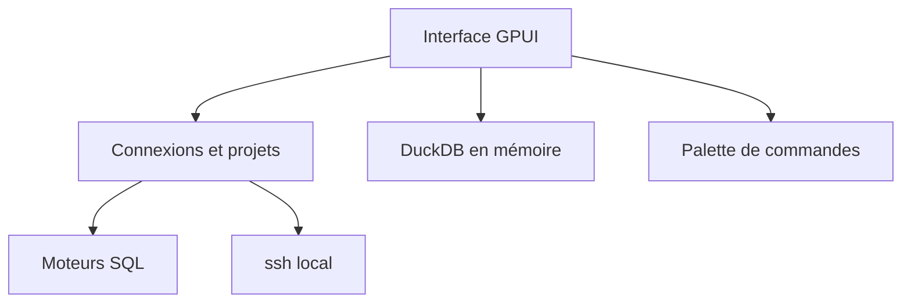

# ShayanAbbas1/dbdelve

> Lightweight native database client written in Rust, for those who find DBeaver too heavy.

## The problem
Common SQL clients are either heavy (Electron, JVM), paid, and struggle with large tables.

## What it actually does
Multi-engine client in Rust with GPUI. Imports connections from DBeaver and TablePlus, read-only or read-write modes, preview of UPDATEs before execution, query plan, opening of CSV, Excel, Parquet or JSON files through in-memory DuckDB. SSH tunnels through your own `ssh`.

## How it is wired
Simplified diagram based on the sheet, no diagram provided.



## Trying it
```bash
brew install --cask ShayanAbbas1/dbdelve/dbdelve
xattr -dr com.apple.quarantine /Applications/DBDelve.app
```

## Cost and gotchas
Free, no telemetry apart from an update check that can be disabled. Application not notarized on macOS. Created in August 2026: young, with a single visible author.

## What it is not
Not a full equivalent of DBeaver: feature parity is announced "over time". Benchmarks are supplied by the author.

## Alternatives
- DBeaver: more complete, but heavier (comparison from the README).
- TablePlus: paid, the source of the connection imports.

## For you
Keep an eye on it: interesting for exploring Parquet or CSV quickly, but too recent to replace your SQL client.
