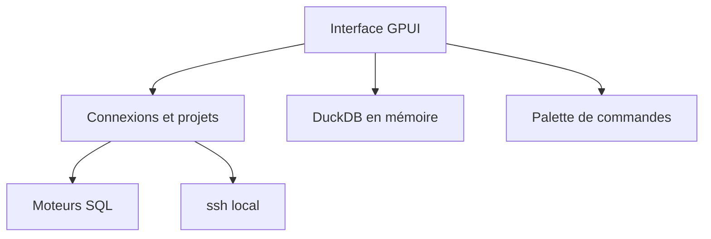

# ShayanAbbas1/dbdelve

> Client de bases de données natif en Rust, léger, pour qui trouve DBeaver trop lourd.

## Le problème
Les clients SQL courants sont soit lourds (Electron, JVM), soit payants, et peinent sur de grosses tables.

## Ce que ça fait vraiment
Client multi-moteurs en Rust avec GPUI. Importe les connexions de DBeaver et TablePlus, modes lecture seule ou lecture-écriture, aperçu des UPDATE avant exécution, plan de requête, ouverture de CSV, Excel, Parquet ou JSON via DuckDB en mémoire. Tunnels SSH via ton propre `ssh`.

## Comment c'est branché
Schéma simplifié d'après la fiche, sans diagramme fourni.



## Essayer
```bash
brew install --cask ShayanAbbas1/dbdelve/dbdelve
xattr -dr com.apple.quarantine /Applications/DBDelve.app
```

## Coût et pièges
Gratuit, sans télémétrie hormis une vérification de mise à jour désactivable. Application non notarisée sur macOS. Créé en août 2026 : jeune, avec un seul auteur visible.

## Ce que ce n'est pas
Pas un équivalent complet de DBeaver : la parité de fonctions est annoncée « avec le temps ». Benchmarks fournis par l'auteur.

## Alternatives
- DBeaver : plus complet, mais plus lourd (comparaison du README).
- TablePlus : payant, source des imports de connexions.

## Pour toi
Surveiller : intéressant pour explorer Parquet ou CSV vite, mais trop récent pour remplacer ton client SQL.

