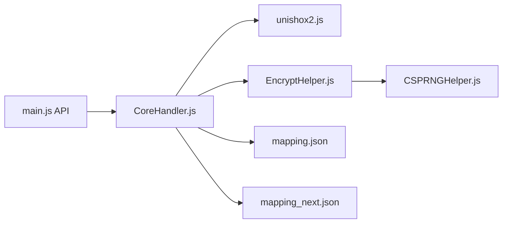

# SheepChef/Abracadabra

> Text encryption that produces classical-style Chinese text, in JavaScript, as a browser extension and on Android.

## The problem
Classical encryption yields unreadable text that attracts attention; here the goal is a result that looks like written Chinese.

## What it actually does
Pipeline: compression (Unishox2 for short text, GZIP beyond), AES-256-CTR (with optional advanced suites: IV, HMAC-SHA256, PBKDF2, TOTP), Base64, three rotors, then mapping to 3000 common Chinese characters and a "simulation" mode producing classical Chinese sentences. It also decodes "熊曰" texts. Available as a static page, a browser extension and an offline APK.

## How it is wired


## Trying it
```bash
# Aucune commande dans le README : voir le « projet principal » (page statique),
# les extensions de navigateur et l'APK en Release.
```

## Cost and gotchas
Free. Private AIPL-1.1 license: usage implies acceptance of the terms, read it before integrating.

## What it is not
Not a guarantee of secrecy through obscurity: the security comes from AES. The ciphertext is much longer than the original.

## Alternatives
No alternative named; projects in the style of 熊曰, 佛曰 and 兽音 are mentioned as inspirations.

## For you
Watch: a curiosity in linguistic steganography, with no data/AI use; the custom license hinders any reuse.
