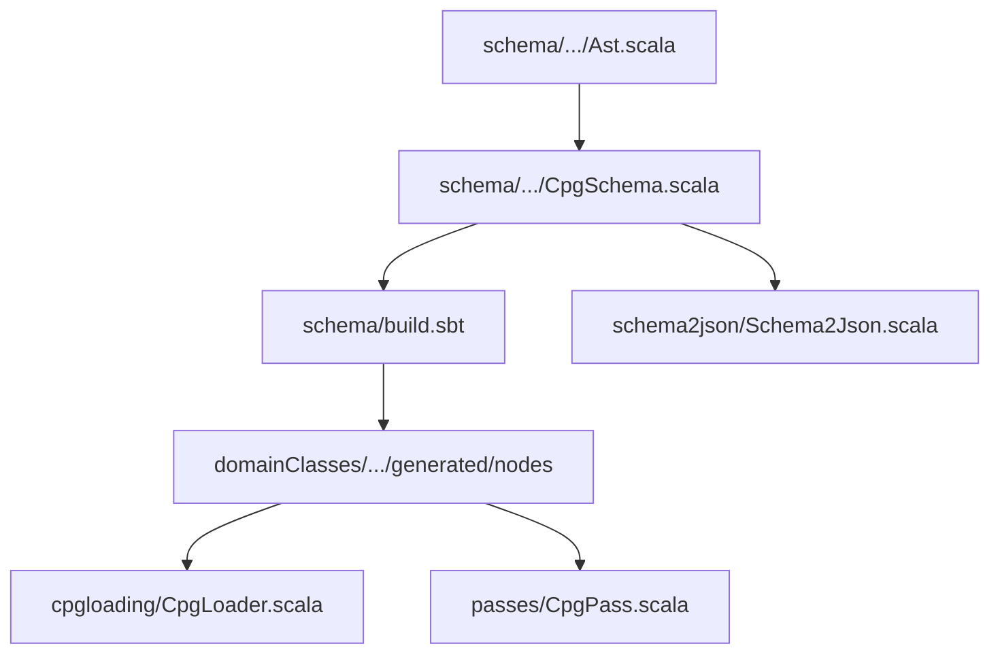

# ShiftLeftSecurity/codepropertygraph

> Scala specification and tooling for the Code Property Graph, a code representation for analysis.

## The problem
Exchanging code in an intermediate representation together with its analysis results lacks a common open format.

## What it actually does
Defines an extensible base schema, generates Scala node and traversal classes from that schema, loads a graph (`CpgLoader`), runs analysis passes (`CpgPass`) and exports the schema as JSON. A query DSL only allows valid steps. The README recommends Joern to get started.

## How it is wired


## Trying it
```bash
sbt clean test publishM2
sbt semanticcpg/console
./schema2json.sh
```

## Cost and gotchas
Java 11, SBT, Git-lfs and Protocol Buffer required. Scala ecosystem; regenerating the test CPGs requires the proprietary java2cpg.

## What it is not
Not a ready-to-use analysis platform: the README points newcomers to Joern.

## Alternatives
- joernio/joern: full platform that combines this repository with a C/C++ frontend.

## For you
Interesting if you do code analysis or code graphs for AI; worth watching, but Joern is the entry point.
