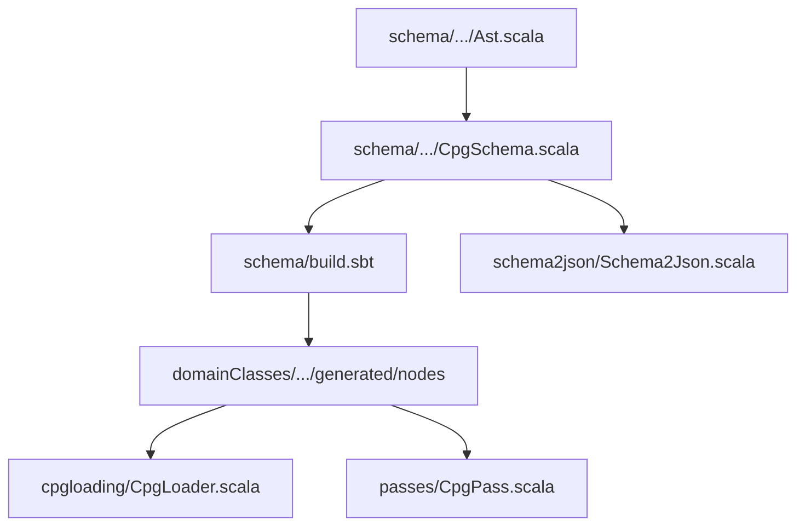

# ShiftLeftSecurity/codepropertygraph

> Spécification et outillage Scala du Code Property Graph, représentation de code pour l'analyse.

## Le problème
Échanger du code en représentation intermédiaire avec ses résultats d'analyse manque d'un format ouvert commun.

## Ce que ça fait vraiment
Définit un schéma de base extensible, génère des classes de nœuds et de parcours Scala depuis ce schéma, charge un graphe (`CpgLoader`), exécute des passes d'analyse (`CpgPass`) et exporte le schéma en JSON. Un DSL de requêtes n'autorise que les étapes valides. Le README recommande Joern pour débuter.

## Comment c'est branché


## Essayer
```bash
sbt clean test publishM2
sbt semanticcpg/console
./schema2json.sh
```

## Coût et pièges
Java 11, SBT, Git-lfs et Protocol Buffer requis. Écosystème Scala ; la régénération des CPG de test exige java2cpg propriétaire.

## Ce que ce n'est pas
Pas une plateforme d'analyse prête à l'emploi : le README oriente les nouveaux venus vers Joern.

## Alternatives
- joernio/joern : plateforme complète qui combine ce dépôt avec un frontal C/C++.

## Pour toi
Intéressant si tu fais de l'analyse de code ou des graphes de code pour l'IA ; à surveiller, mais Joern est le point d'entrée.

