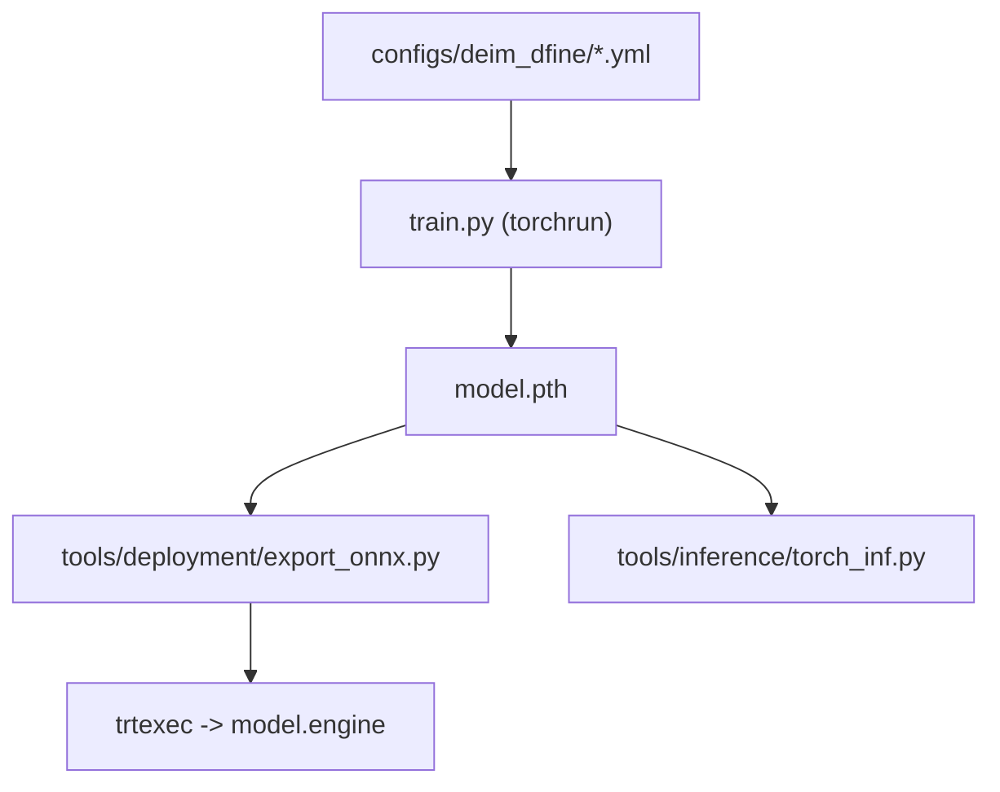

# ShihuaHuang95/DEIM

> Training framework that improves DETR matching to converge faster in real-time detection.

## The problem
DETRs converge slowly and their target matching is inefficient, which costs hours of GPU time.

## What it actually does
Grafts an improved matching method onto D-FINE and RT-DETRv2. On COCO, a gain of 0.2 to 1.2 AP: for example D-FINE-X from 55.8 to 56.5, RT-DETRv2-S from 47.9 to 49.0. Reuses D-FINE's tooling: ONNX/TensorRT export, inference, benchmark, FiftyOne. The README announces follow-ups (DEIMv2, EdgeCrafter).

## How it is wired
No diagram; schema based on the README.


## Trying it
```bash
conda create -n deim python=3.11.9
conda activate deim
pip install -r requirements.txt
CUDA_VISIBLE_DEVICES=0,1,2,3 torchrun --master_port=7777 --nproc_per_node=4 train.py -c configs/deim_dfine/deim_hgnetv2_${model}_coco.yml --use-amp --seed=0
```

## Cost and gotchas
Training is planned on 4 GPUs. You have to prepare COCO by hand. License not identified by GitHub: read it before use.

## What it is not
Not a standalone detector: it is a training recipe applied to D-FINE or RT-DETRv2. The authors already point to DEIMv2, so this repo is no longer their latest version. 92 open issues.

## Alternatives
D-FINE (direct base); DEIMv2 and EdgeCrafter (announced by the README, no link in the excerpt).

## For you
Worth watching: useful if you train D-FINE or RT-DETR and want faster convergence, but look at DEIMv2 first and check the license.
