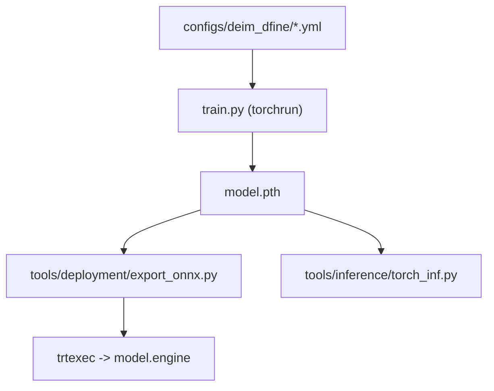

# ShihuaHuang95/DEIM

> Cadre d'entraînement qui améliore l'appariement des DETR pour converger plus vite en détection temps réel.

## Le problème
Les DETR convergent lentement et leur appariement des cibles est peu efficace, ce qui coûte des heures de GPU.

## Ce que ça fait vraiment
Greffe une méthode d'appariement améliorée sur D-FINE et RT-DETRv2. Sur COCO, gain de 0,2 à 1,2 AP : par exemple D-FINE-X de 55,8 à 56,5, RT-DETRv2-S de 47,9 à 49,0. Reprend l'outillage de D-FINE : export ONNX/TensorRT, inférence, benchmark, FiftyOne. Le README annonce des suites (DEIMv2, EdgeCrafter).

## Comment c'est branché
Pas de diagramme ; schéma d'après le README.


## Essayer
```bash
conda create -n deim python=3.11.9
conda activate deim
pip install -r requirements.txt
CUDA_VISIBLE_DEVICES=0,1,2,3 torchrun --master_port=7777 --nproc_per_node=4 train.py -c configs/deim_dfine/deim_hgnetv2_${model}_coco.yml --use-amp --seed=0
```

## Coût et pièges
Entraînement prévu sur 4 GPU. Il faut préparer COCO à la main. Licence non identifiée par GitHub : à lire avant usage.

## Ce que ce n'est pas
Pas un détecteur indépendant : c'est une recette d'entraînement qui s'applique à D-FINE ou RT-DETRv2. Les auteurs orientent déjà vers DEIMv2, donc ce dépôt n'est plus leur dernière version. 92 issues ouvertes.

## Alternatives
D-FINE (base directe) ; DEIMv2 et EdgeCrafter (annoncés par le README, sans lien dans l'extrait).

## Pour toi
Surveiller : utile si tu entraînes D-FINE ou RT-DETR et veux gagner en convergence, mais regarde DEIMv2 d'abord et vérifie la licence.

