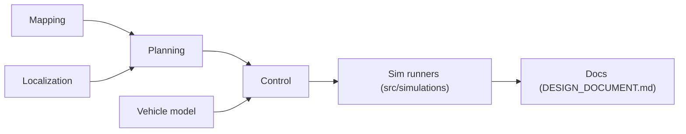

# ShisatoYano/AutonomousVehicleControlBeginnersGuide

> Collection of Python simulations of autonomous driving algorithms, for learning localization, planning and path tracking.

## The problem
Autonomous vehicle algorithms are scattered across papers; readable, tested implementations are rare.

## What it actually does
Educational Python code (NumPy, SciPy, Matplotlib): localization (extended and unscented Kalman filters, particle filter), mapping (occupancy grid, NDT), planning (A*, Hybrid A*, D*, RRT*, PRM, PSO, Q-Learning), path tracking (Pure Pursuit, Stanley, LQR, MPC, MPPI), perception. Each simulation is a standalone script with pytest tests. The author is considering a book.

## How it is wired


## Trying it
```bash
git clone https://github.com/ShisatoYano/AutonomousVehicleControlBeginnersGuide
. run_test_suites.sh
python src/simulations/localization/extended_kalman_filter_localization/extended_kalman_filter_localization.py
```

## Cost and gotchas
Free; Python 3.13 expected, native Linux or VM; a Dev Container is provided. Documentation "not finished" according to the author.

## What it is not
Not an autonomous driving stack usable on a vehicle: it is course material.

## Alternatives
No alternative named in the README.

## For you
Worth watching: good support for understanding Kalman filters and planning, but useful for learning, not for production.
