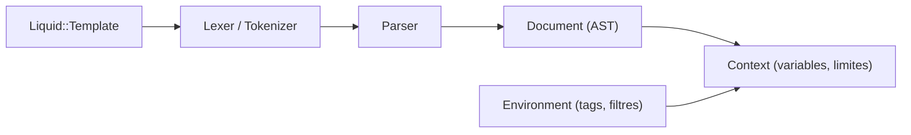

# Shopify/liquid

> Safe Ruby template engine, with no code evaluation, for user-edited templates.

## The problem
Letting users change an application's appearance without them executing code on your server.

## What it actually does
Compiles the template once (lexer, parser, node tree) then renders it with a hash of variables: parse/render separation. Tags and filters are registered in an isolated `Environment`. Error modes (`:lax`, `:warn`, `:strict`, `:strict2`), strict variables and filters, resource limits, optional usage tracking.

## How it is wired


## Trying it
```ruby
gem 'liquid'
@template = Liquid::Template.parse("hi {{name}}")
@template.render('name' => 'tobi')
```

## Cost and gotchas
Free. The default `:lax` mode accepts almost anything: enable `:strict` for editors.

## What it is not
Not a full HTML rendering engine nor a web framework. Score limits do not bound the CPU of loops that produce no output.

## Alternatives
No alternative named in the README.

## For you
Ignore on the Python side: only of interest if you host third-party-written templates in Ruby.
