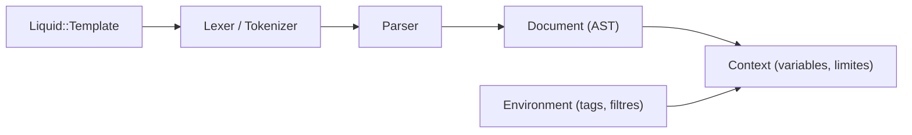

# Shopify/liquid

> Moteur de templates Ruby sûr, sans évaluation de code, pour templates édités par les utilisateurs.

## Le problème
Laisser des utilisateurs modifier l'apparence d'une application sans qu'ils exécutent du code sur ton serveur.

## Ce que ça fait vraiment
Compile le template une fois (lexer, parser, arbre de nœuds) puis le rend avec un hash de variables : séparation parse/render. Les tags et filtres sont enregistrés dans un `Environment` isolé. Modes d'erreur (`:lax`, `:warn`, `:strict`, `:strict2`), variables et filtres stricts, limites de ressources, suivi d'usage optionnel.

## Comment c'est branché


## Essayer
```ruby
gem 'liquid'
@template = Liquid::Template.parse("hi {{name}}")
@template.render('name' => 'tobi')
```

## Coût et pièges
Gratuit. Le mode par défaut `:lax` accepte presque tout : activer `:strict` pour les éditeurs.

## Ce que ce n'est pas
Pas un moteur de rendu HTML complet ni un framework web. Les limites de score ne bornent pas le CPU des boucles sans sortie.

## Alternatives
Aucune alternative nommée dans le README.

## Pour toi
À ignorer côté Python : n'a d'intérêt que si tu héberges des templates écrits par des tiers en Ruby.

