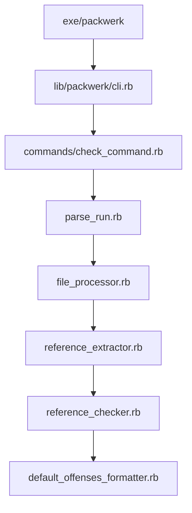

# Shopify/packwerk

> Ruby gem that enforces boundaries between packages in a Rails application.

## The problem
In a large Rails monolith, everything depends on everything, and each change costs more and more.

## What it actually does
`packwerk check` walks the Ruby files, extracts static constant references and compares them with the dependencies declared between packages. Violations are collected and displayed. It avoids false positives at the price of a few false negatives.

## How it is wired


## Trying it
```bash
bundle install
bundle binstub packwerk
bin/packwerk init
```

## Cost and gotchas
Free. Requires Rails 6 with Zeitwerk and Ruby 2.7+ (not in the list of prerequisites). Custom Zeitwerk configurations produce false positives.

## What it is not
Does not track method calls or objects: only constants. Works only for Rails.

## Alternatives
packs (Rust implementation, experimental outside Rails) and packwerk-extensions, both cited in the README.

## For you
Ignore: a Rails modularization tool, unrelated to data, AI or MLOps work.
