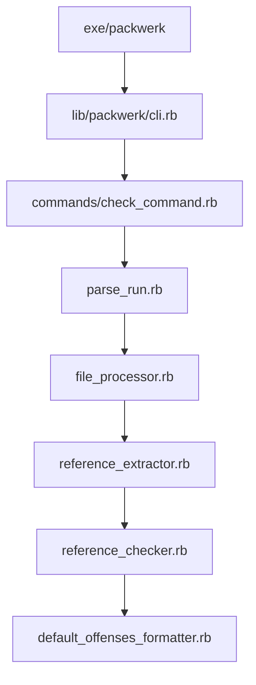

# Shopify/packwerk

> Gem Ruby qui impose des frontières entre paquets dans une application Rails.

## Le problème
Dans un gros monolithe Rails, tout dépend de tout, et chaque changement coûte de plus en plus cher.

## Ce que ça fait vraiment
`packwerk check` parcourt les fichiers Ruby, extrait les références statiques de constantes et les compare aux dépendances déclarées entre paquets. Les violations sont collectées et affichées. Il évite les faux positifs au prix de quelques faux négatifs.

## Comment c'est branché


## Essayer
```bash
bundle install
bundle binstub packwerk
bin/packwerk init
```

## Coût et pièges
Gratuit. Exige Rails 6 avec Zeitwerk et Ruby 2.7+ (hors liste des prérequis). Les configurations Zeitwerk personnalisées produisent des faux positifs.

## Ce que ce n'est pas
Ne suit pas les appels de méthodes ni les objets : seulement les constantes. Ne sert que pour Rails.

## Alternatives
packs (implémentation Rust, expérimentale hors Rails) et packwerk-extensions, tous deux cités dans le README.

## Pour toi
À ignorer : outil de modularisation Rails, sans rapport avec un travail data, IA ou MLOps.

