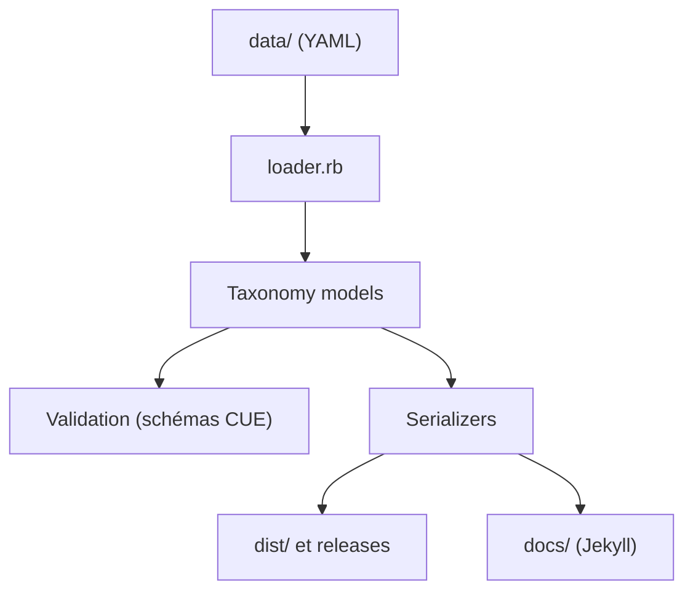

# Shopify/product-taxonomy

> Taxonomie ouverte de produits de Shopify, avec attributs, valeurs et correspondances, pour intégrateurs et data scientists.

## Le problème
Classer des produits de façon cohérente entre catalogues et places de marché exige un vocabulaire commun.

## Ce que ça fait vraiment
Le dépôt contient les données sources en YAML (catégories, attributs, valeurs, motifs de retour), les traductions et les correspondances vers d'autres taxonomies, dont Google. Une application Ruby (`dev/`) valide ces données et génère des fichiers JSON et TXT publiés en versions datées.

## Comment c'est branché
Schéma d'après le diagramme du code.


## Essayer
```bash
curl -L https://github.com/Shopify/product-taxonomy/releases/latest/download/categories.en.json.gz | gunzip > categories.json
cd dev
bundle install
bin/product_taxonomy dist
```

## Coût et pièges
Gratuit. Le dossier `dist/` committé est déprécié et sera retiré le 31 octobre 2026 : utiliser les fichiers des releases. Ruby et cue sont requis seulement pour modifier le projet.

## Ce que ce n'est pas
Ce n'est pas une API : le contrat est un ensemble de fichiers. Ce n'est pas un classifieur automatique de produits.

## Alternatives
Aucune alternative nommée dans le README.

## Pour toi
À surveiller : bon référentiel pour étiqueter ou normaliser des catalogues produits dans un projet de classification.

